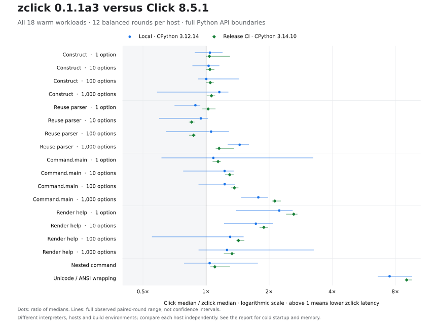

# zclick 0.1.1a3 交付记录

## 发布与安装

**0.1.1a3 已发布到 [PyPI](https://pypi.org/project/zclick/0.1.1a3/) 和 [GitHub Releases](https://github.com/LIghtJUNction/zclick/releases/tag/v0.1.1a3)。** [发布流程 43377480224](https://github.com/LIghtJUNction/zclick/actions/runs/43377480224) 的 **61 个任务全部成功**，标签 `v0.1.1a3` 指向源码 `9afcc7537212563f66a5d99c9f08f99bfa692731`。13 个发行文件由已配置的可信发布者上传，包括 12 个 wheel 和一个源码包。

```sh
python -m pip install --upgrade zclick==0.1.1a3
```

已实际下载全部 16 个 GitHub 公开资产并核对大小和 SHA-256；其中 13 个发行文件与 PyPI 的记录一致。全部 13 份公开发布证明的发布者身份及文件摘要也已核对。首次普通索引安装遇到 PyPI 索引同步延迟，失败记录保留；**2026-11-13 06:30:38 UTC**，第二个仓库外全新环境通过相同的普通 PyPI 索引安装成功，没有使用直接 wheel URL。环境未安装原版 Click，提示输入的问候示例退出码为 0。[完整发布核验](../compatibility/releases/0.1.1a3-pypi.json)

CI 性能测量与正式 GNU wheel 的 **18 个 Python／原生运行时文件内容完全相同**。基准 wheel 的归档 SHA-256 为 `3a8b394925e2ac56830e75dda74b84182480c0449bfac199dc044d0cb8921bc2`，公开 GNU wheel 为 `9316d37ec25f53c18985b0e85e064c5468e36f693acd3d53201c930b89fa9773`；归档本身不同，运行时文件逐项相同。[制品对比证明](../compatibility/releases/0.1.1a3-benchmark-payload.json)

## 本轮结果

本轮将动态解析计划的准备与执行合并为一次原生调用，减少固定协议名称、列表遍历和上下文调度的重复工作，同时修复帮助缓存、参数容器和警告顺序的兼容差异。完整数据来自两次独立记录的 Linux 运行，每次都重新比较固定 Click 8.5.1、已发布的 zclick 0.1.1a2 wheel 和 a3。[英文完整性能报告](performance-0.1.1a3.md)

**相对 a2，单参数重复解析的耗时比为 1.615×／1.674×，嵌套命令为 1.166×／1.143×。** 下文两个数依次代表本地与发布 CI。大型完整调用相对 Click 为 **1.776×／2.128×**，但相对 a2 仅为 **1.042×／1.033×**，其主要优势在上一版本已经存在。

**所有场景大幅超越 Click 的目标尚未达到。** 小型完整调用的中位数在两次运行中均低于 Click，纯解析仍有慢项：本地 1、10 个选项较慢，CI 的 10、100 个选项较慢。帮助输出也有明确的版本回退，详见下文。

## 两次运行的完整比较

比值定义为**参考中位耗时 / a3 中位耗时**，大于 1 表示 a3 耗时更低。1.615× 对应耗时减少约 38.1%，不等于耗时减少 61.5%。表格将对 Click 的比较与对上一版本的新增改善分开。

| 场景 | 本地 Click/a3 | CI Click/a3 | 本地 a2/a3 | CI a2/a3 |
| --- | ---: | ---: | ---: | ---: |
| 命令构造，1 个选项 | 1.043× | 1.037× | 1.020× | 1.006× |
| 重复解析，1 个选项 | 0.890× | 1.023× | 1.615× | 1.674× |
| 完整调用，1 个选项 | 1.083× | 1.141× | 1.079× | 1.097× |
| 帮助文本，1 个选项 | 2.235× | 2.619× | 0.909× | 0.936× |
| 命令构造，10 个选项 | 1.028× | 1.044× | 0.996× | 1.003× |
| 重复解析，10 个选项 | 0.944× | 0.853× | 1.370× | 1.318× |
| 完整调用，10 个选项 | 1.226× | 1.297× | 1.099× | 1.064× |
| 帮助文本，10 个选项 | 1.727× | 1.886× | 1.006× | 0.971× |
| 命令构造，100 个选项 | 1.003× | 1.047× | 1.011× | 1.001× |
| 重复解析，100 个选项 | 1.057× | 0.872× | 1.170× | 1.208× |
| 完整调用，100 个选项 | 1.227× | 1.365× | 1.057× | 1.048× |
| 帮助文本，100 个选项 | 1.303× | 1.427× | 1.020× | 1.016× |
| 命令构造，1,000 个选项 | 1.157× | 1.061× | 1.019× | 0.997× |
| 重复解析，1,000 个选项 | 1.446× | 1.154× | 1.179× | 1.166× |
| 完整调用，1,000 个选项 | 1.776× | 2.128× | 1.042× | 1.033× |
| 帮助文本，1,000 个选项 | 1.259× | 1.329× | 1.017× | 1.014× |
| 嵌套命令 | 1.040× | 1.101× | 1.166× | 1.143× |
| Unicode/ANSI 换行 | 7.507× | 9.055× | 0.978× | 0.988× |



图中点为中位耗时之比，线段为十二轮配对比值的全部观测范围，**不是置信区间**。横轴使用对数刻度；两个环境分别解释，没有合并为一个平均加速比。

1,000 个选项的完整调用，本地从 Click 的 **9.122 ms** 降到 a3 的 **5.138 ms**，发布 CI 从 **11.070 ms** 降到 **5.202 ms**。同轮 a2 分别为 **5.355 ms／5.375 ms**。业务回调仍执行，测量包括上下文、参数解析、类型转换与回调绑定，但复用了已经定义的命令。

纯解析的改善不能直接代替整个命令的改善。单参数重复解析相对 a2，本地从 **2.798 µs** 降到 **1.732 µs**，CI 从 **3.528 µs** 降到 **2.108 µs**。同时，CI 的 100 选项解析中，Click 为 **47.949 µs**，a3 为 **54.997 µs**；这个结果与本地的轻微领先方向不同，两个结果都保留。

### 冷启动、回退与内存

全新进程测量包含解释器启动、导入、命令构造、执行或帮助、输出捕获和退出。全部八个冷启动场景的中位数在两个环境都低于 Click；相对 a2，每个环境各有四个场景更慢。1,000 选项命令的进程耗时，本地 Click／a2／a3 为 **50.539／38.879／38.687 ms**，CI 为 **62.502／48.224／48.833 ms**。一次启动的改善远小于特定文本换行的加速比。[全部冷启动样本与边界](performance-0.1.1a3.md)

单选项帮助相对 a2 的耗时比为 **0.909×／0.936×**。CI 上十选项帮助为 **0.971×**；这两个 CI 场景在十二轮中均没有一轮快于 a2，不能将它们笼统视为随机波动。本轮恢复了 Click 的完整参数容器、缓存和重复警告协议，但组合基准没有单独测量每项修复的因果成本。

Unicode/ANSI 换行相对 Click 仍有 **7.507×／9.055×** 优势，相对 a2 则为 **0.978×／0.988×**。这些数据说明换行不是本轮新增的大幅加速。导入时间也基本持平：本地 a2／a3 均约 **14.175 ms**，CI 为 **18.032／17.991 ms**。

整个测试 worker 的 RSS 中位数，本地 Click／a2／a3 为 **24.062／25.473／25.193 MiB**，CI 为 **32.014／33.262／33.121 MiB**。a3 低于 a2，仍高于 Click。RSS 包含解释器、导入、内容校验、分配记录和全部场景；`tracemalloc` 不能看到全部 Rust 分配，因此没有零分配或全面降低内存的结论。

## 优化具体减少了什么

### 一次原生入口完成准备和解析

原路径需要进入 Rust 校验当前定义，再进入 Rust 执行解析。新的 `_native.parse_live` 在一次调用中完成这两步，减少绑定调用与中间对象。它仍按顺序发布解析计划、读取当前上下文和规范化函数、构造 Python 状态、释放临时对象、求值标志，然后解析并调用当前动作方法。Python 回调可以重入，运行期间的动态修改仍可见。[实现](../crates/zclick-python/src/lib.rs)、[顺序和重入回归](../tests/test_native_parse_live.py)

### 减少重复分配与查找

Rust 绑定通过 PyO3 复用有限的协议字面量，例如属性名和方法名；用户命令名、参数值没有永久驻留。普通精确 list 使用会观察当前长度的游标，列表子类继续走其迭代协议。zclap 的单参数识别命令使用一项存在标记存储，每次匹配仍经过实际 zclap 事件与最终验证。[生命周期与所有权](architecture.md)、[解析核心](../crates/zclick-core/src/parse.rs)

上下文栈的 push 减少一次线程局部读取，命令组调度复用固定协议名称，错误分支的辅助模块在需要时导入。上下文资源释放、自定义类型转换和 Python 方法覆盖继续执行。测量不支持把总收益分配成各项技巧的精确占比。[调度实现](../crates/zclick-python/src/dispatch.rs)

### 兼容性修复与性能一起保留

帮助选项首次创建后的对象身份、参数列表的真值与容器身份、名称去重的哈希顺序，以及调试模式的重复参数警告，均按固定 Click 行为回归。没有为优化跳过警告或冻结用户方法。[配对回归](../tests/test_command_help_protocols.py)

跨平台测试抓到了新入口在 PyPy 上读取不存在的函数 `__builtins__` 属性的问题。修复在模块初始化时捕获对应 builtins 字典，并覆盖字典和模块两种加载器输入；已经用真实 PyPy 验证。修复前的 [`6cdbcd7` 原始测量](../benchmarks/results/cpython312-linux-6cdbcd7.json)仍保留，正式报告采用修复后的完整运行，两个运行没有混合或挑选较快样本。

## 测量来源与可复现范围

| 记录 | 本地 | 发布 CI |
| --- | --- | --- |
| 测量提交 | [`2a9e2c3`](https://github.com/LIghtJUNction/zclick/commit/2a9e2c32a5deb91422902d906894ad33a4de6ff3) | [`9afcc75`](https://github.com/LIghtJUNction/zclick/commit/9afcc7537212563f66a5d99c9f08f99bfa692731) |
| Python | CPython 3.12.14，Clang 22.1.3 | CPython 3.14.10，GCC 15.2.0 |
| CPU | AMD EPYC 9V74；9 个可用逻辑 CPU | AMD EPYC 9V74；4 个可用逻辑 CPU |
| 系统 | Linux 6.18.57、glibc 2.41 | Linux 7.0.0-1019-azure、glibc 2.43 |
| 候选 wheel | 本机构建 manylinux_2_34 | 发行构建 manylinux_2_17 |
| 原始数据 | [本地 JSON](../benchmarks/results/cpython312-linux-2a9e2c3.json) | [CI JSON](../benchmarks/results/cpython314-linux-9afcc75.json) |

两次运行前后工作树均干净，全部 worker 绑定 CPU 0，正常垃圾回收保持启用。每次运行有十二轮，三方六种先后顺序每六轮各执行一次；每个冷启动场景另有平衡顺序。每轮使用新隔离进程，候选和对照由各自只读 wheel 环境提供，输出、源码、原生文件和 lock 哈希均核验。[测量协议](../benchmarks/README.md)

本地测量提交到发布提交的差异仅为原始数据与报告文件，运行时代码及构建配置一致。本地 a2 是已发布的 manylinux_2_17 wheel，而候选是 manylinux_2_34，不能把全部分发差异归因于源码。CI 使用发行 manylinux 构建。两个环境有解释器、系统与编译器差异，CPU 型号相同也不能将跨环境的绝对耗时差异当作代码优化量。

CPU 频率没有锁定，操作系统缓存没有清空，共享主机有调度噪声。全部离群值保留，例如本地 a3 的十选项帮助进程最高 **126.349 ms**，该场景变异系数约 **67.77%**。报告保留墙钟时间、进程 CPU 时间、配对范围、Python 分配和 RSS，未进行删样本或显著性包装。

## 兼容与构建验收

[本次完整验收清单](../compatibility/releases/0.1.1a3.json) 只聚合发布提交的实际工作流、公开证据包与制品核验，未混入旧版本的通过记录。固定官方测试集合为 **33,459 个唯一 ID**，普通测试为 2,459 项，另有 31,000 项压力测试。逐项对照确认 Click 与 zclick 的结果一致，原版 skip 和预期失败保持原条件。

| 环境 | 官方普通测试 | 本项目补充测试 |
| --- | --- | --- |
| Linux CPython 3.10–3.15、3.14t、3.15t | 2,434 通过、24 跳过、1 预期失败 | 367 通过、7 跳过 |
| Linux PyPy 3.11、3.12 | 2,434 通过、24 跳过、1 预期失败 | 363 通过、11 跳过 |
| macOS CPython 3.14 | 2,433 通过、25 跳过、1 预期失败 | 367 通过、7 跳过 |
| Windows CPython 3.14 | 2,357 通过、101 跳过、1 预期失败 | 369 通过、5 跳过 |

七个压力环境各覆盖完整的 31,000 个 ID。六个环境全部执行通过；Windows 为 30,000 项通过、1,000 项原版条件跳过，这 1,000 项不计为执行通过。每个完整环境的普通测试与压力测试并集均匹配固定集合哈希。

其他已执行检查包括：12 个环境各 196 项公开 API 审计及 12 个类型示例；Rust 的 23 项测试、格式与 Clippy 检查、核心 wasm32 `no_std` 构建和依赖许可审计；Bash、Zsh、Fish、PowerShell 的 9 项真实 Shell 集成测试。12 个发行 wheel 均在相应运行环境实际安装并执行；源码包也重新构建成 wheel 后执行，不能仅凭文件标签推断平台通过。

wheel 覆盖 Linux glibc/musl、macOS、Windows 的 x86-64 与 ARM64，以及 Linux 上的 PyPy 3.11／3.12、自由线程 CPython 3.14／3.15。兼容验证矩阵、制品安装检查和性能实测的范围分别记录，其他架构没有被宣称具有同样的加速比。

## 已知边界

固定兼容目标继续是 **Click 8.5.1**，没有混入其他版本的语义。Rust 1.99.1／Edition 2024、registry zclap 0.1.4 和 PyO3 0.30.1 未改变。核心仍为 `no_std + alloc`，Python 运行时没有第三方依赖，也不依赖原版 Click。[依赖审计](../scripts/audit_dependencies.py)

**子解释器兼容仍未完成，因此 a3 仍为 alpha。** 原生模块在子解释器中明确拒绝初始化，稳定发布门禁继续阻止带有未完成兼容项的稳定版。`CliRunner` 仍会改变解释器状态，不能作为线程间并发隔离工具。第三方扩展若内部导入原版 Click，仍需单独迁移与验证。[兼容边界](../COMPATIBILITY.md)、[扩展验证](extensions.md)

## 复现实验

在记录的提交上使用同一 Python 解释器构建候选，在干净目录中运行：

```sh
maturin build --release --locked --out dist/benchmark-candidate
python benchmarks/compare.py \
  --candidate-wheel dist/benchmark-candidate/*.whl \
  --iterations 1000 --repeats 12 --seed 20261111 --affinity auto \
  --output reports/benchmarks-0.1.1a3.json
```

候选目录只放本次构建的一份 wheel。默认基线锁定实际发布的 a2 和固定 Click；历史 a1 锁仍可显式选择用于复现旧报告。正式计时期间停止并行构建和本地测试，不将短诊断输出当作正式结果。
