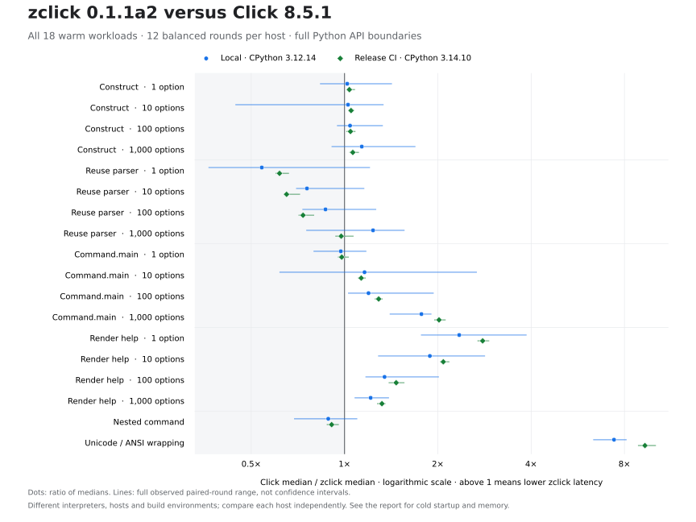
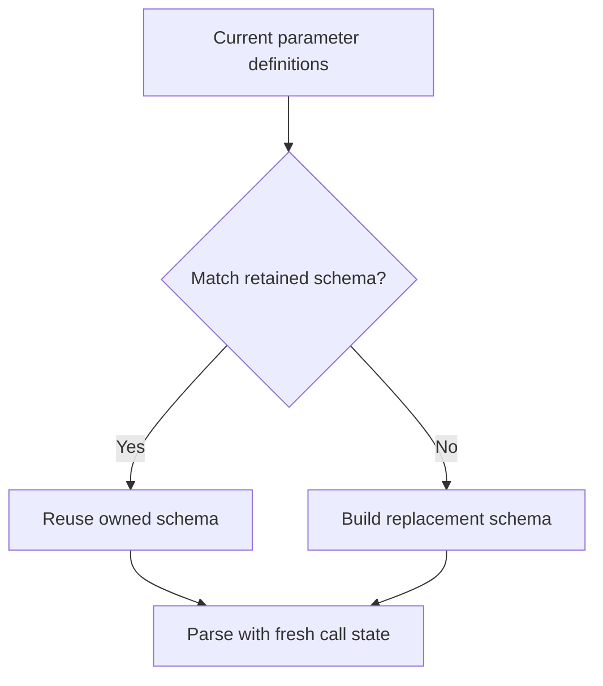

# Measured performance: 0.1.1a2

Two independently recorded Linux hosts show a large improvement over published
zclick 0.1.1a1 in reused parsing: the 1,000-option median ratios are **2.535×**
locally and **2.354×** in release CI. Complete warm invocation at that size
measured **1.771×** and **2.017×** relative to Click 8.5.1. Its improvement over
a1 is much smaller: **1.042×** locally and **1.050×** in CI.

The parser comparison with Click differs between hosts. The local
1,000-option ratio of **1.236×** was **not reproduced** in CI, which measured
**0.975×**. Parsing with 1, 10 and 100 options, the one-option warm invocation
and the nested-command case remained slower than Click on both hosts.
Unicode/ANSI wrapping measured **7.404×** locally and **9.314×** in CI relative
to Click. These are workload comparisons, not a universal application speedup.

The [local schema-2 report](../benchmarks/results/cpython312-linux-c949d30.json)
and [release-CI schema-2 report](../benchmarks/results/cpython314-linux-7e3d597.json)
preserve all samples and distribution identities. Their results are presented
separately below; neither replaces the other. The published a1 wheel was
measured again alongside the candidate in each run. The
[0.1.1a1 report](performance.md) retains its original historical measurements.



The chart shows all eighteen warm workloads from both reports. A ratio above
one means lower a2 latency. Its source is
[`plot_results.py`](../benchmarks/plot_results.py); exact values and boundaries
remain in the tables below.

## Local source, distributions and environment

- Measured source: [`c949d301f815c882acce9a96fe2a0c3b8da9bded`](https://github.com/LIghtJUNction/zclick/commit/c949d301f815c882acce9a96fe2a0c3b8da9bded), version 0.1.1a2. The working tree was clean before and after measurement.
- Reference: Click 8.5.1 at the [fixed target](../compatibility/target.json); published baseline: zclick 0.1.1a1 from commit `3281e18f215dec976c3ce0c4b5dd933ad4d62616`.
- Time: 2026-11-11, 15:41:54–15:42:47 UTC; approximately 53.31 seconds for the complete run.
- Interpreter: CPython 3.12.14, built with Clang 22.1.3; ordinary GIL build.
- Host: Linux 6.18.57 x86-64, glibc 2.41, AMD EPYC 9V74 80-Core Processor. Nine logical CPUs were available to the process; the orchestrator and every recorded warm worker used CPU affinity `[0]`.
- Method: twelve rounds, two complete blocks of all six implementation orders, seed `20261111`, five warmup calls per case and normal garbage collection enabled.
- Build dependencies: Rust 1.99.1 / Edition 2024, registry zclap 0.1.4 and PyO3 0.30.1. The raw report retains Cargo.lock and native-file hashes.

The published baseline is a `manylinux_2_17` wheel; the candidate was built on
this host as `manylinux_2_34`. Python, measurement host and execution ordering
were controlled, while the wheel build environments were not identical.
**This is a comparison of these distributions; their entire difference cannot
be attributed to source changes alone.** The separate release-CI section below
uses the distribution build environment and keeps this local result intact.

| Distribution | Wheel SHA-256 |
| --- | --- |
| Click 8.5.1, `py3-none-any` | `8bb5376d2006950386f8c6427613334a2acadc5f559cb80e638d00b4df957e37` |
| zclick 0.1.1a1, `cp310-abi3-manylinux2014_x86_64.manylinux_2_17_x86_64` | `457e6d01343ccc39cc925ac86ab0e43b6c85e45a165af14e06f37c827ee13a98` |
| zclick 0.1.1a2, `cp310-abi3-manylinux_2_34_x86_64` | `c4ca0d46e04d23647f9798c823bd65464a2a46312bed650f13bebc30ef39aaa2` |

## Local complete warm measurements

Times are median **microseconds per call** across the twelve rounds. Ratios are
reference median divided by a2 median: **above one means lower a2 latency**.
The last two columns compare a2 separately with Click and the published a1
wheel. Each sample is a batch average; 1,000 base iterations are scaled to 100
for 100 options and 10 for 1,000 options. Help uses one fifth as many iterations,
with a minimum of five.

| Workload (options) | Click µs | 0.1.1a1 µs | 0.1.1a2 µs | Click / a2 | a1 / a2 |
| --- | ---: | ---: | ---: | ---: | ---: |
| Construct (1) | 3.531 | 4.019 | 3.461 | 1.020× | 1.161× |
| Reuse parser (1) | 1.615 | 3.676 | 2.986 | 0.541× | 1.231× |
| Command.main (1) | 26.360 | 27.416 | 27.102 | 0.973× | 1.012× |
| Render help (1) | 57.060 | 27.218 | 24.339 | 2.344× | 1.118× |
| Construct (10) | 30.168 | 33.534 | 29.397 | 1.026× | 1.141× |
| Reuse parser (10) | 6.454 | 14.951 | 8.531 | 0.757× | 1.753× |
| Command.main (10) | 76.794 | 79.324 | 66.191 | 1.160× | 1.198× |
| Render help (10) | 105.197 | 71.652 | 55.817 | 1.885× | 1.284× |
| Construct (100) | 310.082 | 338.752 | 297.633 | 1.042× | 1.138× |
| Reuse parser (100) | 56.213 | 153.455 | 64.755 | 0.868× | 2.370× |
| Command.main (100) | 591.708 | 581.755 | 495.180 | 1.195× | 1.175× |
| Render help (100) | 519.249 | 473.968 | 385.705 | 1.346× | 1.229× |
| Construct (1,000) | 3,709.103 | 3,544.436 | 3,263.086 | 1.137× | 1.086× |
| Reuse parser (1,000) | 781.337 | 1,602.245 | 632.171 | 1.236× | 2.535× |
| Command.main (1,000) | 9,990.399 | 5,877.708 | 5,642.273 | 1.771× | 1.042× |
| Render help (1,000) | 4,412.628 | 4,663.276 | 3,634.296 | 1.214× | 1.283× |
| Nested command | 43.626 | 53.976 | 49.233 | 0.886× | 1.096× |
| Unicode/ANSI wrapping | 444.634 | 66.823 | 60.056 | 7.404× | 1.113× |

The parser improvement grows with command size. Its median ratio against a1
ranges from 1.231× at one option to 2.535× at 1,000 options. At 100 options, the
2.370× version improvement still leaves a2 behind Click: 64.755 µs versus
56.213 µs. Reusing an owned schema removes repeated setup, while validation,
Python object creation and the current parser actions remain part of the call.
The measurement does not assign a separate time to each of those costs.

Complete invocation includes more than parsing. With 1,000 options, a2 took
5.642 ms, compared with 9.990 ms for Click and 5.878 ms for a1. Context creation,
parameter processing, conversion and callbacks remain timed. The 1.042× a1/a2
ratio is considerably smaller than the parser-only ratio, and its paired round
ratios range from 0.861 to 1.424. It is not evidence of a large new improvement
in complete invocation over the previous release.

Small differences need the same restraint. One-option construction measured
1.020× relative to Click; one-option invocation measured 0.973× relative to
Click and 1.012× relative to a1. Their sample ranges overlap substantially.
The nested-command median remains slower than Click at 0.886×, despite a
1.096× ratio relative to a1.

### Process CPU time

The driver also records process CPU time in **microseconds per call**, with the
same workload boundaries. These medians track the wall-time results closely;
all eighteen rows are retained here.

| Workload (options) | Click CPU µs | a1 CPU µs | a2 CPU µs | Click / a2 | a1 / a2 |
| --- | ---: | ---: | ---: | ---: | ---: |
| Construct (1) | 3.538 | 4.026 | 3.463 | 1.022× | 1.163× |
| Reuse parser (1) | 1.620 | 3.681 | 2.991 | 0.542× | 1.231× |
| Command.main (1) | 26.367 | 27.422 | 27.109 | 0.973× | 1.012× |
| Render help (1) | 57.078 | 27.240 | 24.365 | 2.343× | 1.118× |
| Construct (10) | 30.175 | 33.544 | 29.406 | 1.026× | 1.141× |
| Reuse parser (10) | 6.462 | 14.960 | 8.511 | 0.759× | 1.758× |
| Command.main (10) | 76.802 | 79.327 | 66.194 | 1.160× | 1.198× |
| Render help (10) | 105.216 | 71.680 | 55.844 | 1.884× | 1.284× |
| Construct (100) | 309.918 | 338.803 | 297.408 | 1.042× | 1.139× |
| Reuse parser (100) | 56.276 | 153.522 | 64.817 | 0.868× | 2.369× |
| Command.main (100) | 591.787 | 581.840 | 494.410 | 1.197× | 1.177× |
| Render help (100) | 519.532 | 473.453 | 386.014 | 1.346× | 1.227× |
| Construct (1,000) | 3,710.012 | 3,542.843 | 3,264.220 | 1.137× | 1.085× |
| Reuse parser (1,000) | 781.994 | 1,603.135 | 631.543 | 1.238× | 2.538× |
| Command.main (1,000) | 9,990.811 | 5,878.642 | 5,641.594 | 1.771× | 1.042× |
| Render help (1,000) | 4,413.623 | 4,664.611 | 3,635.874 | 1.214× | 1.283× |
| Nested command | 43.632 | 53.973 | 49.198 | 0.887× | 1.097× |
| Unicode/ANSI wrapping | 444.235 | 66.835 | 60.049 | 7.398× | 1.113× |

## Local complete fresh-process measurements

These median **milliseconds per process** include interpreter startup, package
import, public command construction, invocation or help, output capture and
process exit. Each row uses twelve fresh processes per implementation. These
boundaries describe a CLI that runs once rather than a reused command object.

| Fresh-process workload (options) | Click ms | a1 ms | a2 ms | Click / a2 | a1 / a2 |
| --- | ---: | ---: | ---: | ---: | ---: |
| Command (1) | 38.774 | 37.379 | 31.020 | 1.250× | 1.205× |
| Render help (1) | 41.239 | 39.253 | 32.284 | 1.277× | 1.216× |
| Command (10) | 37.475 | 35.875 | 29.753 | 1.260× | 1.206× |
| Render help (10) | 40.367 | 39.830 | 31.178 | 1.295× | 1.277× |
| Command (100) | 38.340 | 38.440 | 31.303 | 1.225× | 1.228× |
| Render help (100) | 44.410 | 40.902 | 33.707 | 1.318× | 1.213× |
| Command (1,000) | 58.250 | 57.386 | 43.584 | 1.336× | 1.317× |
| Render help (1,000) | 58.043 | 56.828 | 45.922 | 1.264× | 1.238× |

All eight a2 medians are lower than both references in this run. The
1,000-option command measured 43.584 ms versus 58.250 ms for Click and 57.386 ms
for a1; the corresponding help process measured 45.922 ms versus 58.043 ms and
56.828 ms. Individual runs varied substantially, as shown below, so these
medians do not imply that every startup is faster.

### Import-only startup

The import interval starts immediately before importing the package; only
`time` is imported beforehand. The whole-process interval additionally includes
interpreter startup, reporting the timing and process exit.

| Boundary | Click ms | a1 ms | a2 ms | Click / a2 | a1 / a2 |
| --- | ---: | ---: | ---: | ---: | ---: |
| Import interval | 21.830 | 21.980 | 15.776 | 1.384× | 1.393× |
| Whole import-only process | 37.732 | 38.169 | 29.158 | 1.294× | 1.309× |

The a2 import interval ranged from 13.826 to 19.960 ms, compared with
18.742–27.341 ms for Click and 18.355–26.606 ms for a1. Whole import-only process
ranges were 25.148–38.470 ms, 32.285–45.852 ms and 31.643–51.145 ms respectively.
Operating-system caches were not flushed.

## Local Python allocation observations and process RSS

Each cell below is **current / peak Python-managed bytes**, taking the median
of the twelve observations. `tracemalloc` starts after a collection, observes
one call and keeps its returned value alive for the current-byte reading.
It does not count all Rust allocations or all memory in a retained schema.

| Workload (options) | Click bytes | a1 bytes | a2 bytes |
| --- | ---: | ---: | ---: |
| Construct (1) | 3,250 / 3,290 | 3,418 / 3,458 | 3,370 / 3,410 |
| Reuse parser (1) | 720 / 2,488 | 1,030 / 1,330 | 1,059 / 1,327 |
| Command.main (1) | 3,208 / 7,274 | 3,558 / 7,160 | 3,597 / 7,274 |
| Render help (1) | 1,830 / 5,288 | 1,414 / 2,996 | 1,414 / 2,996 |
| Construct (10) | 20,212 / 20,252 | 20,380 / 20,420 | 20,332 / 20,372 |
| Reuse parser (10) | 1,024 / 2,792 | 2,054 / 2,522 | 1,340 / 1,680 |
| Command.main (10) | 5,456 / 14,857 | 5,478 / 14,891 | 5,275 / 14,606 |
| Render help (10) | 2,394 / 7,102 | 2,098 / 4,850 | 2,098 / 4,850 |
| Construct (100) | 189,788 / 189,828 | 189,956 / 189,996 | 189,908 / 189,948 |
| Reuse parser (100) | 4,816 / 6,584 | 13,046 / 16,362 | 5,065 / 7,517 |
| Command.main (100) | 20,900 / 93,387 | 14,370 / 98,577 | 12,092 / 96,297 |
| Render help (100) | 9,325 / 25,999 | 9,029 / 23,729 | 9,029 / 23,729 |
| Construct (1,000) | 1,887,924 / 1,887,972 | 1,888,092 / 1,888,140 | 1,888,044 / 1,888,084 |
| Reuse parser (1,000) | 35,456 / 54,560 | 115,686 / 163,850 | 35,749 / 54,281 |
| Command.main (1,000) | 71,300 / 780,943 | 86,418 / 919,413 | 6,682 / 832,314 |
| Render help (1,000) | 79,526 / 215,608 | 79,230 / 213,339 | 79,230 / 213,339 |
| Nested command | 3,680 / 9,810 | 4,838 / 10,007 | 5,024 / 10,254 |
| Unicode/ANSI wrapping | 5,576 / 42,128 | 5,120 / 8,126 | 5,056 / 8,062 |

At 1,000 options, reused parsing recorded a Python peak of 54,281 bytes for a2,
compared with 163,850 for a1 and 54,560 for Click. Complete invocation recorded
832,314 bytes for a2, below a1's 919,413 and above Click's 780,943. These are
Python allocation observations for the stated calls, not total native memory
or a zero-allocation result.

Peak RSS measures the **whole worker process**, including imports, package
hash verification, `tracemalloc` and the full workload sequence. It cannot be
attributed to one parser call. Values below use MiB, where 1 MiB is 1,048,576
bytes.

| Implementation | Median peak RSS MiB | Observed range MiB |
| --- | ---: | ---: |
| Click 8.5.1 | 24.059 | 24.000–24.066 |
| zclick 0.1.1a1 | 25.107 | 25.004–25.199 |
| zclick 0.1.1a2 | 25.492 | 25.438–25.527 |

The candidate's median worker peak RSS was higher than both references:
25.492 MiB versus 24.059 MiB for Click and 25.107 MiB for a1. The lower Python
allocation readings in some rows therefore do not establish lower overall
process memory use.

## Local variability and limits of the comparison

The following ranges preserve all twelve warm samples for representative
large, small and regressing workloads. Paired ratios divide a1 by a2 within
each round; they differ from the ratio of the two overall medians.

| Warm workload | Click range µs | a1 range µs | a2 range µs | Paired a1/a2 range |
| --- | ---: | ---: | ---: | ---: |
| Construct (1) | 3.393–4.923 | 3.626–4.206 | 3.267–4.110 | 0.882–1.287 |
| Command.main (1) | 23.133–31.486 | 24.549–37.098 | 24.214–32.051 | 0.784–1.194 |
| Reuse parser (1,000) | 721.620–1,068.995 | 1,526.422–2,164.517 | 581.890–1,009.144 | 1.705–3.720 |
| Command.main (1,000) | 8,865.453–11,015.180 | 5,360.613–8,106.337 | 5,219.943–6,946.573 | 0.861–1.424 |
| Nested command | 40.973–53.011 | 50.487–66.509 | 44.592–61.140 | 0.868–1.373 |
| Unicode/ANSI wrapping | 408.196–465.175 | 61.677–75.341 | 56.728–66.192 | 0.952–1.254 |

For the 1,000-option reused parser, every paired a1/a2 round ratio exceeded one,
with a range of 1.705–3.720. Against Click, paired ratios ranged from
0.756–1.555 despite the 1.236× overall median ratio. Wrapping's paired
Click/a2 ratios ranged from 6.370–8.094. These observations support the stated
workload comparisons while retaining their variability; they are not confidence
intervals or guarantees for another machine.

Fresh-process samples show larger outliers. The table includes every cold
workload's observed range in milliseconds and a2's coefficient of variation
(CV: sample standard deviation divided by the sample mean).

| Fresh-process workload | Click range ms | a1 range ms | a2 range ms | a2 CV |
| --- | ---: | ---: | ---: | ---: |
| Command (1) | 34.661–131.940 | 32.859–46.649 | 26.805–42.308 | 13.79% |
| Render help (1) | 36.208–51.935 | 35.062–47.180 | 28.003–63.983 | 27.98% |
| Command (10) | 34.135–52.948 | 32.928–44.715 | 26.693–36.993 | 9.83% |
| Render help (10) | 35.674–45.786 | 34.832–45.513 | 28.775–36.114 | 8.00% |
| Command (100) | 33.506–47.887 | 32.786–184.678 | 27.871–70.480 | 34.33% |
| Render help (100) | 37.362–59.717 | 35.515–48.203 | 27.842–149.031 | 78.43% |
| Command (1,000) | 50.130–85.201 | 44.417–92.699 | 40.450–48.855 | 6.10% |
| Render help (1,000) | 51.308–66.934 | 48.063–66.654 | 41.193–51.773 | 6.94% |

The a2 100-option help process had a 33.707 ms median and a 149.031 ms maximum,
with a CV of 78.43%. Click's one-option command reached 131.940 ms and a1's
100-option command reached 184.678 ms. These samples were retained. A claim that
every invocation or cold start is faster would conflict with the recorded data.

Affinity kept the measured workers on CPU 0, but frequency was not locked and
no frequency readings were available. The host's one-minute load observation
rose from about 0.46 to 1.33. Shared-host activity, scheduling, file caches and
GC can affect the run; balanced implementation order reduces one source of
bias without removing those conditions. Hash seeds also vary across isolated
Python processes. No statistical significance claim is made for the small
median differences above.

The build-target difference is another attribution limit. Comparing the
published a1 `manylinux_2_17` wheel with a host-built a2 `manylinux_2_34` wheel
measures their delivered behavior under this interpreter, including build
differences. Component-level attribution and portability require their own
comparisons. The historical report and this local run remain intact alongside
the separate release-CI result below.

## Independent release-CI measurement

The second run used the release build environment and a different host and
Python version. It confirms the direction of the large parser improvement
over a1, the large full-invocation advantage over Click, and faster wrapping.
It **does not reproduce the local 1,000-option parser advantage over Click**:
the CI median ratio is 0.975×, versus 1.236× locally. The two runs are retained
separately because a change of processor, interpreter and build environment
prevents attributing that difference to any one factor.

### CI source and distribution identity

- Source: [`7e3d597873b737bbfc8c2df090773aad56d9bd73`](https://github.com/LIghtJUNction/zclick/commit/7e3d597873b737bbfc8c2df090773aad56d9bd73), version 0.1.1a2, from [Release run 43052475382](https://github.com/LIghtJUNction/zclick/actions/runs/43052475382). The tree was clean before and after timing.
- Time: 2026-11-11, 15:54:30–15:55:42 UTC, approximately 72.64 seconds for the complete run.
- Host: AMD EPYC 7763 64-Core Processor, Linux 7.0.0-1019-azure x86-64, glibc 2.43; four logical CPUs were available and all recorded measurement workers used CPU 0.
- Interpreter: ordinary-GIL CPython 3.14.10, built with GCC 15.2.0. The same interpreter was used for Click, the published a1 wheel and a2.
- Build: pinned Maturin 1.16.0 and Rust 1.99.1 through the release's manylinux build configuration. Both zclick distributions use `cp310-abi3-manylinux2014_x86_64.manylinux_2_17_x86_64` wheels.
- Protocol: the same twelve rounds, two balanced order blocks, seed `20261111`, five warmup calls, normal GC and separately ordered fresh-process boundaries as the local run.
- Raw evidence: [complete CI JSON](../benchmarks/results/cpython314-linux-7e3d597.json), SHA-256 `4e6fcaddeae2e2c0c3d932b000d649e622408f64261b895d0b81c31a7505afbd`.

The independently built benchmark wheel and release Linux GNU wheel have
different archive hashes. Their **18 Python and native runtime files have
identical content**, including the native binary. This connects the measured
runtime to the release artifact without claiming byte-identical wheel archives.
The [file-by-file comparison](../compatibility/releases/0.1.1a2-benchmark-payload.json)
retains every matched runtime hash and the comparison scope. It does not by
itself establish publication or performance on another architecture.

| Artifact | SHA-256 |
| --- | --- |
| CI benchmark wheel | `3d1834c08c5072faafa23e6e172404ce8fab90e0dbd0120eb1398aec14c539c4` |
| Release Linux GNU wheel archive | `dd69bc1b014559a0c77319f52334811951e49fb134f916a3e76f5b7abd493a0c` |
| Native binary in both wheels | `c87443a4805193f89d243f87c21bdc92480a79cee796899c47591851c0131746` |

### All eighteen CI warm workloads

These are median **microseconds per call**, with the same workload boundaries
and iteration scaling as the local table. Both reference ratios use the CI
medians; no values are mixed between hosts.

| Workload (options) | Click µs | a1 µs | a2 µs | Click / a2 | a1 / a2 |
| --- | ---: | ---: | ---: | ---: | ---: |
| Construct (1) | 6.199 | 6.847 | 5.981 | 1.036× | 1.145× |
| Reuse parser (1) | 2.907 | 5.987 | 4.711 | 0.617× | 1.271× |
| Command.main (1) | 68.058 | 73.169 | 69.487 | 0.979× | 1.053× |
| Render help (1) | 160.319 | 69.845 | 57.461 | 2.790× | 1.216× |
| Construct (10) | 51.102 | 56.406 | 48.681 | 1.050× | 1.159× |
| Reuse parser (10) | 8.576 | 22.096 | 13.192 | 0.650× | 1.675× |
| Command.main (10) | 147.040 | 144.753 | 129.905 | 1.132× | 1.114× |
| Render help (10) | 232.380 | 138.535 | 111.570 | 2.083× | 1.242× |
| Construct (100) | 509.940 | 561.699 | 487.971 | 1.045× | 1.151× |
| Reuse parser (100) | 68.096 | 200.341 | 92.697 | 0.735× | 2.161× |
| Command.main (100) | 928.616 | 803.018 | 720.583 | 1.289× | 1.114× |
| Render help (100) | 896.932 | 788.245 | 611.180 | 1.468× | 1.290× |
| Construct (1,000) | 5,273.717 | 5,711.841 | 4,959.468 | 1.063× | 1.152× |
| Reuse parser (1,000) | 836.866 | 2,019.259 | 857.956 | 0.975× | 2.354× |
| Command.main (1,000) | 14,169.504 | 7,377.726 | 7,023.316 | 2.017× | 1.050× |
| Render help (1,000) | 7,243.400 | 7,158.829 | 5,486.346 | 1.320× | 1.305× |
| Nested command | 119.839 | 135.448 | 131.907 | 0.909× | 1.027× |
| Unicode/ANSI wrapping | 650.213 | 72.940 | 69.811 | 9.314× | 1.045× |

At 1,000 options, the parser improved from 2,019.259 µs in a1 to 857.956 µs in
a2, a 2.354× ratio. Click took 836.866 µs, so a2's parser median was slightly
higher. Complete invocation took 7,023.316 µs versus Click's 14,169.504 µs and
a1's 7,377.726 µs: 2.017× relative to Click, but only 1.050× over a1. Reducing
one part of invocation does not give the complete command the same ratio.

All four parser sizes, the one-option invocation and the nested-command case
remain slower than Click in this CI run. Help and wrapping retain lower
medians: wrapping took 69.811 µs versus Click's 650.213 µs, a 9.314× ratio. Its
ratio over a1 is 1.045×, which separates the project's existing advantage over
Click from this version's smaller additional change.

The process-CPU measurements use the same **microseconds per call** boundary:

| Workload (options) | Click CPU µs | a1 CPU µs | a2 CPU µs | Click / a2 | a1 / a2 |
| --- | ---: | ---: | ---: | ---: | ---: |
| Construct (1) | 6.205 | 6.853 | 5.988 | 1.036× | 1.144× |
| Reuse parser (1) | 2.911 | 5.994 | 4.718 | 0.617× | 1.270× |
| Command.main (1) | 68.059 | 73.175 | 69.492 | 0.979× | 1.053× |
| Render help (1) | 160.315 | 69.872 | 57.480 | 2.789× | 1.216× |
| Construct (10) | 50.993 | 56.421 | 48.687 | 1.047× | 1.159× |
| Reuse parser (10) | 8.581 | 22.101 | 13.195 | 0.650× | 1.675× |
| Command.main (10) | 147.035 | 144.759 | 129.907 | 1.132× | 1.114× |
| Render help (10) | 232.399 | 138.558 | 111.594 | 2.083× | 1.242× |
| Construct (100) | 509.984 | 561.756 | 487.978 | 1.045× | 1.151× |
| Reuse parser (100) | 68.132 | 200.388 | 92.737 | 0.735× | 2.161× |
| Command.main (100) | 928.631 | 803.069 | 720.598 | 1.289× | 1.114× |
| Render help (100) | 897.150 | 788.537 | 611.386 | 1.467× | 1.290× |
| Construct (1,000) | 5,273.917 | 5,712.415 | 4,960.191 | 1.063× | 1.152× |
| Reuse parser (1,000) | 836.913 | 2,019.739 | 858.365 | 0.975× | 2.353× |
| Command.main (1,000) | 14,145.645 | 7,378.331 | 7,021.754 | 2.015× | 1.051× |
| Render help (1,000) | 7,243.795 | 7,159.815 | 5,487.554 | 1.320× | 1.305× |
| Nested command | 119.835 | 135.441 | 131.909 | 0.908× | 1.027× |
| Unicode/ANSI wrapping | 650.206 | 72.948 | 69.812 | 9.314× | 1.045× |

### All eight CI fresh-process workloads

Values are median **milliseconds per process**, including startup, import,
construction, command or help execution, output capture and exit.

| Fresh-process workload (options) | Click ms | a1 ms | a2 ms | Click / a2 | a1 / a2 |
| --- | ---: | ---: | ---: | ---: | ---: |
| Command (1) | 47.971 | 46.302 | 39.650 | 1.210× | 1.168× |
| Render help (1) | 54.821 | 51.443 | 45.123 | 1.215× | 1.140× |
| Command (10) | 48.305 | 47.054 | 39.811 | 1.213× | 1.182× |
| Render help (10) | 55.592 | 51.767 | 45.297 | 1.227× | 1.143× |
| Command (100) | 49.844 | 48.244 | 41.480 | 1.202× | 1.163× |
| Render help (100) | 56.866 | 53.410 | 46.616 | 1.220× | 1.146× |
| Command (1,000) | 74.481 | 65.616 | 57.698 | 1.291× | 1.137× |
| Render help (1,000) | 74.790 | 74.878 | 65.037 | 1.150× | 1.151× |

All eight medians were lower than both references. The 1,000-option command
ratio against Click was 1.291×; the corresponding help ratio was 1.150×.
For a2, those observed ranges were 56.739–63.557 ms and 63.850–67.351 ms.
These ranges describe the retained samples, not a guarantee for every startup.

| Import boundary | Click ms | a1 ms | a2 ms | Click / a2 | a1 / a2 |
| --- | ---: | ---: | ---: | ---: | ---: |
| Import interval | 28.171 | 27.430 | 21.891 | 1.287× | 1.253× |
| Whole import-only process | 46.214 | 45.181 | 38.873 | 1.189× | 1.162× |

### CI memory and variability

Whole-worker peak RSS includes imports, package hash validation, the complete
workload sequence and `tracemalloc`. It is not the memory cost of one parser
call. Median a2 RSS remained above Click's; the a2 and a1 observed ranges
overlap. Cross-host absolute RSS values are not directly comparable because
the interpreter and environment differ.

| Implementation | Median peak RSS MiB | Observed range MiB |
| --- | ---: | ---: |
| Click 8.5.1 | 32.039 | 31.957–32.082 |
| zclick 0.1.1a1 | 33.287 | 33.066–33.355 |
| zclick 0.1.1a2 | 33.324 | 33.102–34.270 |

For the 1,000-option parser, median Python peak allocation was **54,355 bytes**
for a2, **175,010 bytes** for a1 and **54,552 bytes** for Click. Complete
invocation instead recorded **840,650.5**, **941,589** and **797,559 bytes**
respectively; the fractional median comes from averaging the middle two
observations. The report retains all eighteen current/peak observations.
`tracemalloc` does not account for all Rust allocation or total process memory.

The table below gives a2's observed warm ranges and coefficient of variation,
and each reference's within-round ratio range. The much smaller dispersion in
this CI run does not erase the local outliers or turn two hosts into a general
performance guarantee.

| Warm workload | a2 range µs | a2 CV | Paired Click/a2 range | Paired a1/a2 range |
| --- | ---: | ---: | ---: | ---: |
| Reuse parser (1) | 4.543–4.847 | 1.99% | 0.602–0.659 | 1.228–1.334 |
| Reuse parser (1,000) | 830.166–895.415 | 2.04% | 0.938–1.065 | 2.240–2.463 |
| Command.main (1) | 68.330–71.134 | 1.19% | 0.957–1.028 | 1.015–1.083 |
| Command.main (1,000) | 7,000.795–7,101.010 | 0.53% | 1.955–2.111 | 1.034–1.075 |
| Nested command | 128.380–135.708 | 1.57% | 0.880–0.954 | 1.005–1.062 |
| Unicode/ANSI wrapping | 68.172–72.966 | 1.97% | 8.884–10.063 | 0.999–1.110 |

The CI 1,000-option parser's paired Click/a2 ratios cross one, from 0.938 to
1.065. Every paired a1/a2 ratio for that parser remained above one, from
2.240 to 2.463. The full-invocation a1/a2 ratios were 1.034–1.075, a modest
change alongside the larger Click comparison. These are observed ranges, not
confidence intervals.

Affinity selected CPU 0; frequency was not locked and no frequency readings
were available. One-minute host load changed from about 1.53 to 1.40. Isolated
process hash seeds, GC, scheduling and file caches still affect measurement.
Both hosts support faster reused parsing than a1 and faster large full
invocation than Click for these workloads. They do not establish uniformly
faster parsing than Click, lower process memory, or a speedup for all existing
Click applications.

## Reusing parser structure

A parser schema is the Rust representation of option spellings and argument
consumption rules. Each command or parser retains at most its most recent owned
schema. Before reuse, the binding reads the current definitions and compares
their structural fields. Matching definitions reuse the schema; changed
definitions produce a replacement. This removes repeated construction of the
same owned names and lookup tables while keeping definition validation inside
each measured invocation. The implementation is in
[`plan.rs`](../crates/zclick-python/src/plan.rs).

The following diagram shows the schema decision within one invocation. Both
branches use fresh parsing state.



The retained schema contains Rust structural data. Defaults, environment
values, contexts, callback results and Python application objects remain
outside it. Parameter registration, parser actions, conversion and callbacks
continue through the current Python methods. These boundaries let an
application change an alias, arity, callback or type method between invocations
without reusing an earlier result. Reentry creates separate invocation state.
The [schema tests](../tests/test_native_plan.py) and
[command mutation tests](../tests/test_cached_command_semantics.py) exercise
these distinctions, including copying and pickling a warmed command.

Parameter ordering retains the same live Python behavior at its extension
points. For exact lists containing at least 512 declared parameters, ordinary
CPython objects may use a guarded Rust ordering operation. It records each
parameter's first invocation position in a lookup table, then performs a stable
sort. This avoids repeated linear `list.index` searches; the complete operation
is not claimed to be linear, since sorting can require O(n log n) work. Smaller lists,
custom protocols and PyPy use Python's `sorted` and `index` operations. The
[ordering regressions](../tests/test_native_ordering.py) cover repeated object
identities, equality, eager getters and custom containers. This selection is
part of the timed invocation rather than an excluded preparation step.

## Input ownership and Python adapter work

The native binding borrows an ordinary argument's interpreter-provided UTF-8
buffer for the duration of the call. It retains the Python owner and records
argument indices so that an existing argument can be returned with its original
identity. Strings containing surrogate code points use a reversible
`surrogatepass` representation. Preparing an interpreter's UTF-8 representation,
handling surrogate strings and creating Python results can still allocate.
The [native boundary tests](../tests/test_native_kernel.py) cover Unicode,
surrogates and distinct empty string subclasses.

The Python adapters also avoid work whose result is already known. Built-in
type selection uses identity checks and reads the current public type singleton
on each call. An exact string can pass through string conversion unchanged;
string subclasses continue through their Python conversion methods. Plain text
width and ANSI removal avoid a native call when their guarded conditions hold,
and formatting wrappers retain observation of replaced native functions. These
changes are covered by [surface regressions](../tests/test_surface_fast_paths.py).

Help preparation keeps its common single-line path small. It imports
`inspect` only when the running standard library is needed to determine the
result, including the whitespace behavior that differs between Python 3.12 and
3.13. Styling and help-table assembly reduce temporary helper objects while
preserving output and callback evaluation order. Integer conversion continues
to use Python integers, with the same arbitrary precision and current custom
conversion methods described in the [architecture](architecture.md).

These mechanisms explain which work changed. A complete version comparison
measures their combined effect together with parsing, binding and Python
execution. Assigning a measured percentage to one mechanism would require a
separate component comparison.

## What the benchmark measures

Every workload uses the same public Python entry point and checks its result
across all three implementations. The driver retains construction, repeated
use and fresh-process execution as distinct boundaries. The full workload
definitions are in [`compare.py`](../benchmarks/compare.py).

| Boundary | Sizes | Work inside the measurement |
| --- | --- | --- |
| Command construction | 1, 10, 100 and 1,000 options | Public `Option` and `Command` construction |
| Reused parser | All four sizes | `parse_args`, a fresh argument-list copy, definition validation, parsing and parser actions |
| Warm command invocation | All four sizes | `Command.main`, context creation, parser setup, conversion and the command callback |
| Warm help rendering | All four sizes | `get_help`, help assembly, widths and wrapping |
| Nested command | One parent and child | Group resolution, child invocation and result handling |
| Unicode and ANSI wrapping | One fixed paragraph | Public `wrap_text` on the same text and width |
| Fresh-process import | Each implementation | Import interval and whole-process elapsed time, reported separately |
| Fresh-process command and help | All four sizes | Interpreter startup, import, command construction, invocation or help, output capture and exit |

The warm invocation reuses an already-created command. Its schema validation
and Python hooks remain timed; command construction has its own row.
Fresh-process rows include construction and startup, so they also show whether
a change helps a CLI that runs once and exits. The fixed command callbacks sum
converted integer values. Application-specific I/O, interactive prompts and
expensive business callbacks need additional application measurements.

## Reproducing a formal comparison

Build the candidate from a frozen checkout. The following Linux example reproduces the protocol and uses
a dedicated output directory so that the wheel argument identifies the intended
candidate:

```sh
maturin build --release --locked --out dist/benchmark-candidate
python benchmarks/compare.py \
  --candidate-wheel dist/benchmark-candidate/*.whl \
  --iterations 1000 --repeats 12 --seed 20261111 --affinity auto \
  --output reports/benchmarks-0.1.1a2.json
```

Use the exact wheel filename if the directory contains more than one wheel.
Omit `--affinity auto` on platforms without Linux affinity control. The driver
selects the first allowed CPU when that option is used and records the original
and selected affinity. Frequency and shared-host activity remain observed
conditions rather than controlled constants.

The driver installs the published baseline and candidate into separate
environments using the same interpreter and Click wheel. It verifies the
published wheel hashes and installed package contents. Formal runs also require
the candidate version and Python source files to match the checkout. Reports
retain the source commit, native-file hashes, Cargo.lock hash, benchmark source
hashes and environment observations. See the
[measurement protocol](../benchmarks/README.md) for the complete provenance
checks and the separate harness diagnostic mode.

Each of the twelve rounds uses a fresh isolated worker for each implementation.
Within every six-round block, all six implementation orders occur once, in a
seeded order. Each cold workload has its own seeded schedule. The driver checks
results before warm timing and compares complete help and wrapping output
hashes. It records all wall-time and process-CPU samples, keeps normal garbage
collection enabled and verifies the package snapshots again after measurement.

The worker processes run outside the source checkout with isolated Python.
Operating-system caches are not flushed, and the order of workloads inside a
worker remains fixed. The report records these conditions. A quiet local
measurement interval excludes concurrent project builds and tests, while the
retained host observations describe activity outside the project's control.

## Claim and evidence record

The measurement establishes performance only for the recorded workload,
distributions, interpreter and host. The following mapping separates the
mechanism evidence from the numerical conclusions.

| Claim | Evidence | Scope |
| --- | --- | --- |
| Current definitions are checked before an owned schema is reused | `plan.rs`, `test_native_plan.py`, `test_cached_command_semantics.py` | Implemented mechanism and focused regression cases |
| Python callbacks, comparisons and conversion changes remain observable | `test_dynamic_semantics.py`, `test_native_ordering.py`, `test_native_parameter_hooks.py`, `test_native_parameter_guard_edges.py` | Specific covered behaviors; release verification is tied to its source commit |
| Input handling preserves surrogate data and argument identity | `test_native_kernel.py`, `test_native_plan.py` | Covered native-boundary cases |
| Reused parsing at 1,000 options improved relative to the published a1 wheel | Local `parse/1000`: 1,602.245 µs to 632.171 µs, 2.535×; CI: 2,019.259 µs to 857.956 µs, 2.354× | All paired a1/a2 rounds favored a2 on both recorded hosts |
| Warm invocation at 1,000 options has a lower median than Click | Local `invoke/1000`: 1.771×; CI: 2.017× | The change over a1 is much smaller, at 1.042× locally and 1.050× in CI |
| Reused parsing at 1,000 options is consistently faster than Click | Local `parse/1000`: 1.236×; CI: 0.975× | Unsupported across these two hosts; the local advantage did not reproduce |
| The measured CI runtime corresponds to the release GNU wheel | File-by-file comparison of all 18 Python/native runtime files | Identical runtime contents; different wheel archive SHA-256 values |
| Every Click application becomes substantially faster | Small parser, one-option invocation and nested-command results; cold outliers | Unsupported; no universal speedup is claimed |

Performance conclusions remain separate from compatibility completion.
The [subinterpreter compatibility gap](../compatibility/known-gaps.json) remains
open, so 0.1.1a2 is a prerelease. The release completed its full validation
workflow and is available on
[GitHub](https://github.com/LIghtJUNction/zclick/releases/tag/v0.1.1a2) and
[PyPI](https://pypi.org/project/zclick/0.1.1a2/), with tag `v0.1.1a2` fixed to
`7e3d597873b737bbfc8c2df090773aad56d9bd73`.
The [release validation record](../compatibility/releases/0.1.1a2.json) records
the fixed upstream inventory, API contracts, original platform skips and
actual shell checks. The [publication verification](../compatibility/releases/0.1.1a2-pypi.json)
records the 12 wheels and source archive, their matching PyPI/GitHub hashes,
and an isolated PyPI installation. Passing these checks does not close the
disclosed subinterpreter gap or expand the performance conclusions beyond
the measured workloads.
