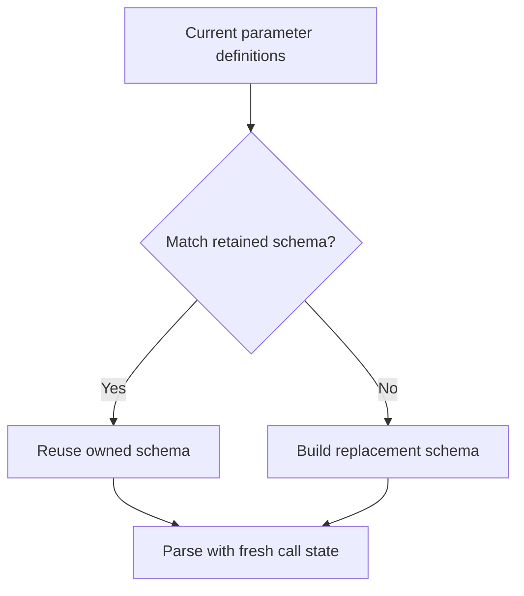

# Performance mechanisms and measurement: 0.1.1a2

Version 0.1.1a2 reduces repeated parser setup and work in the Python adapters
while retaining the fixed [Click 8.5.1 contract](../compatibility/target.json).
This document describes the implemented mechanisms and the measurement method.
**Formal performance results for 0.1.1a2 have not yet been added.** The
[0.1.1a1 measurements](performance.md) remain a separate historical record.

The comparison uses three implementations: Click 8.5.1, the published zclick
0.1.1a1 wheel and the frozen 0.1.1a2 candidate wheel. This separates the question
of compatibility-target performance from the question of improvement over the
previous zclick release. The [baseline lock](../benchmarks/baseline-lock.json)
identifies the published distributions and their hashes.

## Reusing parser structure

A parser schema is the Rust representation of option spellings and argument
consumption rules. Each command or parser retains at most its most recent owned
schema. Before reuse, the binding reads the current definitions and compares
their structural fields. Matching definitions reuse the schema; changed
definitions produce a replacement. This removes repeated construction of the
same owned names and lookup tables while keeping definition validation inside
each measured invocation. The implementation is in
[`plan.rs`](../crates/zclick-python/src/plan.rs).

The following diagram shows the schema decision within one invocation. Both
branches use fresh parsing state.



The retained schema contains Rust structural data. Defaults, environment
values, contexts, callback results and Python application objects remain
outside it. Parameter registration, parser actions, conversion and callbacks
continue through the current Python methods. These boundaries let an
application change an alias, arity, callback or type method between invocations
without reusing an earlier result. Reentry creates separate invocation state.
The [schema tests](../tests/test_native_plan.py) and
[command mutation tests](../tests/test_cached_command_semantics.py) exercise
these distinctions, including copying and pickling a warmed command.

Parameter ordering retains the same live Python behavior at its extension
points. For exact lists containing at least 512 declared parameters, ordinary
CPython objects may use a guarded Rust ordering operation. Smaller lists,
custom protocols and PyPy use Python's `sorted` and `index` operations. The
[ordering regressions](../tests/test_native_ordering.py) cover repeated object
identities, equality, eager getters and custom containers. This selection is
part of the timed invocation rather than an excluded preparation step.

## Input ownership and Python adapter work

The native binding borrows an ordinary argument's interpreter-provided UTF-8
buffer for the duration of the call. It retains the Python owner and records
argument indices so that an existing argument can be returned with its original
identity. Strings containing surrogate code points use a reversible
`surrogatepass` representation. Preparing an interpreter's UTF-8 representation,
handling surrogate strings and creating Python results can still allocate.
The [native boundary tests](../tests/test_native_kernel.py) cover Unicode,
surrogates and distinct empty string subclasses.

The Python adapters also avoid work whose result is already known. Built-in
type selection uses identity checks and reads the current public type singleton
on each call. An exact string can pass through string conversion unchanged;
string subclasses continue through their Python conversion methods. Plain text
width and ANSI removal avoid a native call when their guarded conditions hold,
and formatting wrappers retain observation of replaced native functions. These
changes are covered by [surface regressions](../tests/test_surface_fast_paths.py).

Help preparation keeps its common single-line path small. It imports
`inspect` only when the running standard library is needed to determine the
result, including the whitespace behavior that differs between Python 3.12 and
3.13. Styling and help-table assembly reduce temporary helper objects while
preserving output and callback evaluation order. Integer conversion continues
to use Python integers, with the same arbitrary precision and current custom
conversion methods described in the [architecture](architecture.md).

These mechanisms explain which work changed. A complete version comparison
measures their combined effect together with parsing, binding and Python
execution. Assigning a measured percentage to one mechanism would require a
separate component comparison.

## What the benchmark measures

Every workload uses the same public Python entry point and checks its result
across all three implementations. The driver retains construction, repeated
use and fresh-process execution as distinct boundaries. The full workload
definitions are in [`compare.py`](../benchmarks/compare.py).

| Boundary | Sizes | Work inside the measurement |
| --- | --- | --- |
| Command construction | 1, 10, 100 and 1,000 options | Public `Option` and `Command` construction |
| Reused parser | All four sizes | `parse_args`, a fresh argument-list copy, definition validation, parsing and parser actions |
| Warm command invocation | All four sizes | `Command.main`, context creation, parser setup, conversion and the command callback |
| Warm help rendering | All four sizes | `get_help`, help assembly, widths and wrapping |
| Nested command | One parent and child | Group resolution, child invocation and result handling |
| Unicode and ANSI wrapping | One fixed paragraph | Public `wrap_text` on the same text and width |
| Fresh-process import | Each implementation | Import interval and whole-process elapsed time, reported separately |
| Fresh-process command and help | All four sizes | Interpreter startup, import, command construction, invocation or help, output capture and exit |

The warm invocation reuses an already-created command. Its schema validation
and Python hooks remain timed; command construction has its own row.
Fresh-process rows include construction and startup, so they also show whether
a change helps a CLI that runs once and exits. The fixed command callbacks sum
converted integer values. Application-specific I/O, interactive prompts and
expensive business callbacks need additional application measurements.

Memory measurements retain their own scope. `tracemalloc` records Python-managed
allocations while the returned value remains alive; it does not cover every
Rust allocation. Peak RSS records the whole worker process, including the
interpreter and its complete workload sequence. The retained schema also has a
memory cost. These observations cannot establish a zero-allocation claim or
isolate native parser memory by themselves.

## Reproducing a formal comparison

Build the candidate from a frozen checkout. The following Linux example uses
a dedicated output directory so that the wheel argument identifies the intended
candidate:

```sh
maturin build --release --locked --out dist/benchmark-candidate
python benchmarks/compare.py \
  --candidate-wheel dist/benchmark-candidate/*.whl \
  --iterations 1000 --repeats 12 --seed 20261111 --affinity auto \
  --output reports/benchmarks-0.1.1a2.json
```

Use the exact wheel filename if the directory contains more than one wheel.
Omit `--affinity auto` on platforms without Linux affinity control. The driver
selects the first allowed CPU when that option is used and records the original
and selected affinity. Frequency and shared-host activity remain observed
conditions rather than controlled constants.

The driver installs the published baseline and candidate into separate
environments using the same interpreter and Click wheel. It verifies the
published wheel hashes and installed package contents. Formal runs also require
the candidate version and Python source files to match the checkout. Reports
retain the source commit, native-file hashes, Cargo.lock hash, benchmark source
hashes and environment observations. See the
[measurement protocol](../benchmarks/README.md) for the complete provenance
checks and the separate harness diagnostic mode.

Each of the twelve rounds uses a fresh isolated worker for each implementation.
Within every six-round block, all six implementation orders occur once, in a
seeded order. Each cold workload has its own seeded schedule. The driver checks
results before warm timing and compares complete help and wrapping output
hashes. It records all wall-time and process-CPU samples, keeps normal garbage
collection enabled and verifies the package snapshots again after measurement.

The worker processes run outside the source checkout with isolated Python.
Operating-system caches are not flushed, and the order of workloads inside a
worker remains fixed. The report records these conditions. A quiet local
measurement interval excludes concurrent project builds and tests, while the
retained host observations describe activity outside the project's control.

## Evidence and interpretation

Mechanism evidence and performance evidence answer different questions. Source
and regression tests show how reuse, mutation and ownership are handled.
Measured latency and memory results must come from the frozen candidate's
formal report. The following record keeps those claims separate.

| Claim | Evidence | Status in this document |
| --- | --- | --- |
| Current definitions are checked before an owned schema is reused | `plan.rs`, `test_native_plan.py`, `test_cached_command_semantics.py` | Implemented mechanism with focused regressions |
| Python callbacks and conversion changes remain observable | `test_dynamic_semantics.py`, `test_native_parameter_hooks.py`, `test_native_parameter_guard_edges.py` | Behavior covered by focused regression cases; release results belong to their exact commit |
| Input handling preserves surrogate data and argument identity | `test_native_kernel.py`, `test_native_plan.py` | Boundary cases covered by focused regressions |
| Published and candidate packages are measured separately under a balanced order | `baseline-lock.json`, `prepare_baseline.py`, `compare.py`, `test_benchmark_protocol.py` | Implemented schema-2 measurement protocol |
| 0.1.1a2 is faster than Click or 0.1.1a1 for a particular workload | Frozen-candidate formal timing and memory report | Awaiting formal results |

When results are added, each row will retain the absolute times for Click,
published zclick and the candidate. Ratios use reference median time divided
by candidate median time; values above one mean lower candidate latency for
that workload. The report also retains paired round ratios and the complete
samples. Regressions remain part of the comparison.

The old report used a different execution protocol. Comparing one of its times
directly with a new run would mix implementation changes with changes in
ordering, host conditions or interpreter version. The new three-way run
remeasures the published wheel alongside the candidate to provide the relevant
version comparison. Small differences and results from a single workload need
that context before they can support a practical speedup claim.

Performance conclusions remain separate from compatibility completion.
The [subinterpreter compatibility gap](../compatibility/known-gaps.json) remains
open, so 0.1.1a2 is a prerelease. Its release evidence must still include the
fixed upstream inventory, API contracts, platform behavior and actual shell
completion checks described in [COMPATIBILITY.md](../COMPATIBILITY.md).
