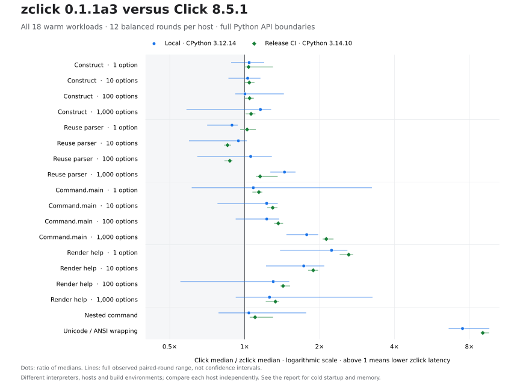

# Measured performance: 0.1.1a3

**Published preview:** zclick 0.1.1a3 is available from
[PyPI](https://pypi.org/project/zclick/0.1.1a3/) and
[GitHub Releases](https://github.com/LIghtJUNction/zclick/releases/tag/v0.1.1a3).
The published tag points to `9afcc7537212563f66a5d99c9f08f99bfa692731`;
[release validation](../compatibility/releases/0.1.1a3.json) records all 61
workflow jobs succeeding. [Public installation verification](../compatibility/releases/0.1.1a3-pypi.json)
confirms the published package separately from the benchmark environments.
The known subinterpreter compatibility gap remains open.

Two independent Linux runs compare the measured a3 build with fixed Click 8.5.1 and the
published zclick 0.1.1a2 wheel. The local run uses CPython 3.12.14 at commit
`2a9e2c3`; release CI uses CPython 3.14.10 at `9afcc75`. Both hosts identify as
AMD EPYC 9V74, but their interpreter, operating system and build environments
differ. Each result is kept as its own twelve-round experiment.

Small full invocation improved relative to a2 on both runs. One-option
Command.main ratios are **1.079× locally** and **1.097× in CI**;
the nested-command ratios are **1.166×** and
**1.143×**. The larger version changes are in
reused parsing: one option measured **1.615×** and
**1.674×** relative to a2. These results do not establish a
universal large improvement in complete applications.

The comparison with Click depends on the workload and environment. One-option
parsing is slower locally (**0.890×**) but slightly faster in CI
(**1.023×**); 100-option parsing goes from **1.057×** locally to
**0.872×** in CI. Ten-option parsing remains slower than Click in
both runs. The 1,000-option full-invocation ratios against Click are
**1.776×** locally and **2.128×** in CI, while their ratios
against a2 are only **1.042×** and **1.033×**.
Most of that advantage over Click predates this revision.

Regressions remain visible. One-option help and Unicode/ANSI wrapping have
higher median latency than a2 on both runs; ten-option help also regresses in
CI. Four of eight complete fresh-process medians are slower than a2 in each
run, though the affected cases differ. Import-only medians are almost unchanged
locally and differ only slightly in CI. Wrapping is **7.507×** and
**9.055×** faster than Click for the measured input, but its
a2/a3 ratios of **0.978×** and **0.988×** show that
this is an existing advantage rather than a new improvement in a3.

The [local schema-2 report](../benchmarks/results/cpython312-linux-2a9e2c3.json)
and [release-CI schema-2 report](../benchmarks/results/cpython314-linux-9afcc75.json)
retain every sample and distribution identity. The published a2 wheel was
measured again alongside the candidate in each run. The [a2 report](performance-0.1.1a2.md)
and [a1 report](performance.md) retain their original historical results.
An [earlier local candidate run](../benchmarks/results/cpython312-linux-6cdbcd7.json)
predates the PyPy import correction and is superseded by the fixed local run.
Its samples are not pooled with either new run, and timing differences between
the two local runs cannot be attributed to the import correction alone.

Ratios mean **reference median time / candidate median time**. Above one means
lower candidate latency; below one means higher candidate latency. A ratio of
1.10 means approximately 9.1% less time, not 10% less time. The opening table
collects the comparisons needed to interpret the findings; all eighteen warm
workloads and all eight cold workloads appear in the complete tables below.

| Workload | Local Click / a3 | CI Click / a3 | Local a2 / a3 | CI a2 / a3 |
| --- | ---: | ---: | ---: | ---: |
| Command.main (1) | 1.083× | 1.141× | 1.079× | 1.097× |
| Reuse parser (1) | 0.890× | 1.023× | 1.615× | 1.674× |
| Reuse parser (10) | 0.944× | 0.853× | 1.370× | 1.318× |
| Reuse parser (100) | 1.057× | 0.872× | 1.170× | 1.208× |
| Reuse parser (1,000) | 1.446× | 1.154× | 1.179× | 1.166× |
| Command.main (1,000) | 1.776× | 2.128× | 1.042× | 1.033× |
| Nested command | 1.040× | 1.101× | 1.166× | 1.143× |
| Render help (1) | 2.235× | 2.619× | 0.909× | 0.936× |
| Render help (10) | 1.727× | 1.886× | 1.006× | 0.971× |
| Unicode/ANSI wrapping | 7.507× | 9.055× | 0.978× | 0.988× |



The chart keeps both runs visible and is generated by
[`plot_results.py`](../benchmarks/plot_results.py). Exact medians, variance and
measurement boundaries remain in the tables.

## Local source, distributions and environment

The experiment fixes the Click behavior target and the published version
control independently of the candidate. Package file hashes are recorded and
checked before and after measurement. This prevents a local source edit from
silently changing the published baseline.

| Item | Recorded value |
| --- | --- |
| Candidate source | [`2a9e2c32a5deb91422902d906894ad33a4de6ff3`](https://github.com/LIghtJUNction/zclick/commit/2a9e2c32a5deb91422902d906894ad33a4de6ff3) |
| Source state during timing | Clean before and after; candidate version and all Python file hashes match the frozen checkout |
| Behavioral reference | Click 8.5.1, commit `cf19179e8e2fd54c601378cec9e0d21bb12b6fb1`; [target lock](../compatibility/target.json) |
| Published performance baseline | zclick 0.1.1a2, commit `7e3d597873b737bbfc8c2df090773aad56d9bd73`; [distribution lock](../benchmarks/baseline-lock.json) |
| Measurement interval | 2026-11-13 06:12:49–06:13:35 UTC; 46.65 seconds overall |
| Interpreter | CPython 3.12.14, Clang 22.1.3, ordinary GIL build |
| Host | Linux 6.18.57 x86-64, glibc 2.41, AMD EPYC 9V74 80-Core Processor |
| CPU affinity | Nine logical CPUs available; orchestrator and all measured workers pinned to CPU 0 |
| Repetition and ordering | Twelve rounds, two complete blocks of all six implementation orders; seed `20261111` |
| Warmup and collection | Five warmup calls per workload and round; normal garbage collection enabled |
| Rust dependencies | Rust 1.99.1, Edition 2024; registry zclap 0.1.4 and PyO3 0.30.1 |
| Raw report SHA-256 | `d652b4a2293c3282aa3c8c0fde61e524fbe710d0aaef4e51a7f1d55d0087fa1f` |
| Candidate native file SHA-256 | `e6ee14999248235b5928fe1c5102d39bae9885fd9b05652061b8583d410bb63a` |
| Cargo.lock SHA-256 | `e1388e66bad5c93c59bfcfd9deecc1255c201fa18a30bc170d95c1459d5a969b` |
| Baseline lock SHA-256 | `f7960066066e89299d8b550fc02ed9d9f9184b94814125fe691861de205170ae` |

**Table 1. Actual distributions measured.** Filenames and hashes identify the
wheels installed into the isolated environments.

| Distribution | Wheel filename | Wheel SHA-256 |
| --- | ---: | ---: |
| Click 8.5.1 | `click-8.5.1-py3-none-any.whl` | `8bb5376d2006950386f8c6427613334a2acadc5f559cb80e638d00b4df957e37` |
| Published zclick 0.1.1a2 | `zclick-0.1.1a2-cp310-abi3-manylinux2014_x86_64.manylinux_2_17_x86_64.whl` | `dd69bc1b014559a0c77319f52334811951e49fb134f916a3e76f5b7abd493a0c` |
| Candidate zclick 0.1.1a3 | `zclick-0.1.1a3-cp310-abi3-manylinux_2_34_x86_64.whl` | `154c50dfd6659089a959075570bea30ab3eb93a0d0bbf3644b0c859ef871bc51` |

The published a2 wheel targets `manylinux_2_17`; the candidate is a host build
targeting `manylinux_2_34`. The interpreter, measurement host and execution
schedule are controlled, but the build environments are not identical.
**The entire measured difference cannot be attributed to source changes
alone.** A later distribution build on another host needs its own measurement
and provenance; the independent CI section below keeps that measurement separate.

## What changed and what the measurements cover

The main change reduces the number of Python-to-Rust calls in reused parsing.
The parser previously validated its current definitions and then entered
native parsing separately. The new entry point performs those operations in
one call while preserving publication of the owned plan and the order of
normalizer lookup, Python state construction, flag evaluation and resource
release. Dynamic hooks still execute. This mechanism is documented in
[the architecture](architecture.md#one-invocation) and implemented in
[`plan.rs`](../crates/zclick-python/src/plan.rs) and
[`parser.py`](../python/zclick/parser.py). The experiment compares the complete
distributions; it does not isolate the number of microseconds contributed by
this change alone.

Smaller changes reduce repeated work without caching application results.
The binding reuses a finite set of literal protocol names such as `process`
and `nargs`; user-defined names and values remain owned. Exact lists of
parameter definitions use a live cursor, so mutation during an attribute
lookup remains visible, and list subclasses keep their Python iterator
protocol. Each zclap candidate command uses one-argument presence storage,
while successful matches still require zclap's event and final validation.
These changes are described in
[the ownership section](architecture.md#mutation-recursion-and-ownership)
and [`parse.rs`](../crates/zclick-core/src/parse.rs).

Group dispatch reuses the same fixed protocol names and context-stack push
performs one thread-local lookup. The implementation continues to use
`threading.local`: an attempted direct `_thread` import was reverted to keep
the pinned upstream light-import behavior. Error-only helpers are imported
when needed. Context managers, Python overrides, conversion and callback calls
remain observable; there is no cache of default values, environment results,
contexts or callback results. The relevant source is
[`dispatch.rs`](../crates/zclick-python/src/dispatch.rs),
[`globals.py`](../python/zclick/globals.py) and
[`core.py`](../python/zclick/core.py).

This revision also fixes observable help and parameter behavior. It preserves
the target's parameter-container identity, help-option cache and dynamic
attribute access order, constructor truthiness and duplicate-parameter
warnings. Those are compatibility changes, not evidence of a speedup. Their
paired regression cases are in
[`test_command_help_protocols.py`](../tests/test_command_help_protocols.py).
The tables retain the help regressions instead of removing this cost from the
comparison.

### Measurement boundaries

The driver measures four distinct operations at each of four sizes. Keeping
the boundaries separate shows where a parser improvement affects a complete
command and where other work dominates.

| Boundary | Included work |
| --- | --- |
| Construct | Public option and command construction for 1, 10, 100 or 1,000 options |
| Reuse parser | A fresh argument list, live definition validation, token processing and current parser actions through an already-created parser |
| Command.main | Invocation of an already-created command, including context creation, parsing, conversion, callback binding and return; `standalone_mode=False` |
| Render help | Public help generation for an already-created command and context |
| Nested command | A group resolving and invoking a child with one integer option and a checked result |
| Unicode/ANSI wrapping | Public wrapping on fixed Unicode and ANSI-containing text with a checked complete output |
| Fresh-process command or help | Interpreter startup, import, construction, invocation or `--help`, output capture and exit |

Each warm worker starts in an isolated interpreter with `-I`, outside the
source checkout. Its imports and file hashes are verified before and after
measurement. Every round starts a new worker per implementation; each six-round
block contains all six implementation orders once. Cold workloads have their
own balanced order schedules. The warm driver checks and retains full help and wrapped-text hashes, parsed
values, option object identity and callback return values across implementations.
Cold-process output is also validated by the driver, but the report does not
retain a separate stdout hash for every cold sample. The complete method is in
[the protocol](../benchmarks/README.md) and
[`compare.py`](../benchmarks/compare.py).

## All eighteen local warm wall-time measurements

**Table 2. Median microseconds per call; lower time is better.** Each of the
twelve observations is a batch average. Base batches contain 1,000 calls,
scaled to 100 calls at 100 options and ten at 1,000 options; help uses one fifth
as many calls with a minimum of five. The two ratio columns use the same a3
median and separate Click and published-a2 references.

| Workload (options) | Click µs ↓ | a2 µs ↓ | a3 µs ↓ | Click / a3 ↑ | a2 / a3 ↑ |
| --- | ---: | ---: | ---: | ---: | ---: |
| Construct (1) | 3.495 | 3.419 | 3.352 | 1.043× | 1.020× |
| Reuse parser (1) | 1.541 | 2.798 | 1.732 | 0.890× | 1.615× |
| Command.main (1) | 24.329 | 24.220 | 22.455 | 1.083× | 1.079× |
| Render help (1) | 55.361 | 22.529 | 24.773 | 2.235× | 0.909× |
| Construct (10) | 29.213 | 28.304 | 28.413 | 1.028× | 0.996× |
| Reuse parser (10) | 6.091 | 8.840 | 6.453 | 0.944× | 1.370× |
| Command.main (10) | 70.358 | 63.041 | 57.386 | 1.226× | 1.099× |
| Render help (10) | 95.230 | 55.477 | 55.133 | 1.727× | 1.006× |
| Construct (100) | 286.798 | 289.088 | 285.954 | 1.003× | 1.011× |
| Reuse parser (100) | 55.453 | 61.344 | 52.448 | 1.057× | 1.170× |
| Command.main (100) | 554.781 | 477.843 | 452.120 | 1.227× | 1.057× |
| Render help (100) | 477.816 | 373.913 | 366.728 | 1.303× | 1.020× |
| Construct (1,000) | 3,417.822 | 3,009.171 | 2,953.356 | 1.157× | 1.019× |
| Reuse parser (1,000) | 748.167 | 610.192 | 517.490 | 1.446× | 1.179× |
| Command.main (1,000) | 9,122.238 | 5,354.941 | 5,137.751 | 1.776× | 1.042× |
| Render help (1,000) | 4,340.031 | 3,506.862 | 3,448.216 | 1.259× | 1.017× |
| Nested command | 43.249 | 48.478 | 41.584 | 1.040× | 1.166× |
| Unicode/ANSI wrapping | 444.740 | 57.917 | 59.247 | 7.507× | 0.978× |

One-option full invocation took 22.455 µs,
compared with 24.329 µs for Click
and 24.220 µs for a2.
The nested command took 41.584 µs,
compared with 43.249 µs
and 48.478 µs.
These are the small-invocation comparisons this revision set out to improve.
Both Click/a3 paired ranges cross one. The nested case favors a3 over a2 in all
twelve rounds, whereas one-option invocation favors it in eleven. These results
support lower medians on this host; they do not establish an advantage on every
future invocation or interpreter.

The parsing rows show a larger change relative to a2 at small sizes. All twelve
paired rounds favor a3 over a2 at one option, and ten of twelve do so at ten
options, while the Click/a3 median ratios remain 0.890× and
0.944×.
The 100-option and 1,000-option ratios against Click are
1.057× and 1.446×. Only the latter stays
above one throughout this run's paired range. Parsing remains a separate
boundary; its ratio must not be substituted for the complete-command ratio.

Several changes are close to no difference or unfavorable relative to a2.
The a2/a3 ratios for 1,000-option invocation and wrapping are
1.042× and
0.978×. One-option help is
0.909×, a median regression despite its advantage over
Click. Help at ten, 100 and 1,000 options changes only modestly relative to a2.
The full table retains construction differences as well; rounding a ratio to
1.000 is not a test of equivalence.

### Process CPU time

**Table 3. Median process CPU microseconds per call.** The same workload
boundaries and twelve rounds are used. CPU time excludes time when the process
is not scheduled; its agreement with a wall-time result is supporting detail,
not an independent replication.

| Workload (options) | Click CPU µs ↓ | a2 CPU µs ↓ | a3 CPU µs ↓ | Click / a3 ↑ | a2 / a3 ↑ |
| --- | ---: | ---: | ---: | ---: | ---: |
| Construct (1) | 3.500 | 3.424 | 3.357 | 1.043× | 1.020× |
| Reuse parser (1) | 1.544 | 2.801 | 1.735 | 0.890× | 1.614× |
| Command.main (1) | 24.334 | 24.224 | 22.459 | 1.083× | 1.079× |
| Render help (1) | 55.377 | 22.542 | 24.790 | 2.234× | 0.909× |
| Construct (10) | 29.219 | 28.309 | 28.418 | 1.028× | 0.996× |
| Reuse parser (10) | 6.095 | 8.841 | 6.457 | 0.944× | 1.369× |
| Command.main (10) | 70.350 | 63.047 | 57.377 | 1.226× | 1.099× |
| Render help (10) | 95.253 | 55.494 | 55.151 | 1.727× | 1.006× |
| Construct (100) | 286.848 | 289.048 | 286.005 | 1.003× | 1.011× |
| Reuse parser (100) | 55.485 | 61.387 | 52.486 | 1.057× | 1.170× |
| Command.main (100) | 554.834 | 477.913 | 452.117 | 1.227× | 1.057× |
| Render help (100) | 477.986 | 374.053 | 366.907 | 1.303× | 1.019× |
| Construct (1,000) | 3,418.425 | 3,009.925 | 2,954.274 | 1.157× | 1.019× |
| Reuse parser (1,000) | 748.586 | 610.742 | 518.080 | 1.445× | 1.179× |
| Command.main (1,000) | 9,122.508 | 5,262.054 | 5,138.433 | 1.775× | 1.024× |
| Render help (1,000) | 4,341.023 | 3,508.169 | 3,449.452 | 1.258× | 1.017× |
| Nested command | 43.253 | 48.486 | 41.589 | 1.040× | 1.166× |
| Unicode/ANSI wrapping | 440.471 | 57.924 | 59.253 | 7.434× | 0.978× |

## Variation across local warm rounds

**Table 4. Observed a3 ranges, sample coefficient of variation and paired wall
ratios.** CV is sample standard deviation divided by sample mean, in percent.
Each paired ratio divides the reference observation by the candidate observation
from the same round. The faster-round counts retain reversals. Ranges are
observed extrema, not confidence intervals or predictions of future latency.

| Workload (options) | a3 range µs | a3 CV % | Paired Click / a3 range | Paired a2 / a3 range | Faster than Click | Faster than a2 |
| --- | ---: | ---: | ---: | ---: | ---: | ---: |
| Construct (1) | 3.201–3.879 | 5.35 | 0.886–1.194 | 0.874–1.482 | 9/12 | 6/12 |
| Reuse parser (1) | 1.637–2.099 | 7.26 | 0.710–0.934 | 1.317–1.869 | 0/12 | 12/12 |
| Command.main (1) | 20.919–38.728 | 20.78 | 0.615–3.232 | 0.602–2.594 | 9/12 | 11/12 |
| Render help (1) | 22.409–39.837 | 18.40 | 1.393–2.577 | 0.621–3.384 | 12/12 | 2/12 |
| Construct (10) | 27.763–44.629 | 16.09 | 0.864–1.152 | 0.627–1.090 | 7/12 | 6/12 |
| Reuse parser (10) | 6.233–10.257 | 18.14 | 0.600–1.017 | 0.821–1.519 | 1/12 | 10/12 |
| Command.main (10) | 55.108–84.377 | 15.97 | 0.781–1.353 | 0.760–1.220 | 10/12 | 10/12 |
| Render help (10) | 53.036–71.645 | 10.40 | 1.224–2.079 | 0.751–1.118 | 12/12 | 6/12 |
| Construct (100) | 267.936–306.297 | 5.10 | 0.921–1.432 | 0.897–1.319 | 6/12 | 7/12 |
| Reuse parser (100) | 49.200–86.827 | 22.89 | 0.648–1.281 | 0.678–1.817 | 8/12 | 10/12 |
| Command.main (100) | 429.300–596.130 | 10.50 | 0.924–1.371 | 0.830–1.220 | 11/12 | 8/12 |
| Render help (100) | 338.356–830.169 | 33.28 | 0.554–1.504 | 0.436–1.242 | 11/12 | 6/12 |
| Construct (1,000) | 2,871.312–5,748.553 | 30.26 | 0.586–1.273 | 0.535–1.119 | 10/12 | 5/12 |
| Reuse parser (1,000) | 493.089–568.769 | 4.43 | 1.273–1.595 | 1.036–1.259 | 12/12 | 12/12 |
| Command.main (1,000) | 4,966.890–5,959.961 | 5.10 | 1.478–1.967 | 0.856–1.095 | 12/12 | 11/12 |
| Render help (1,000) | 3,289.961–4,702.339 | 10.67 | 0.925–3.250 | 0.728–1.194 | 11/12 | 7/12 |
| Nested command | 39.003–52.925 | 8.76 | 0.789–1.760 | 1.049–1.335 | 8/12 | 12/12 |
| Unicode/ANSI wrapping | 56.795–64.446 | 3.67 | 6.629–9.581 | 0.909–1.169 | 12/12 | 5/12 |

The two small full-invocation improvements are variable. One-option invocation
is faster than a2 in 11 of 12 paired rounds and the nested case in all 12.
The a3 nested-case CV is 8.76%,
and its paired a2/a3 range is
1.049–1.335.
The 100-option help CV is
33.28%; its slowest retained
sample is 0.830 ms.
One-option full invocation also has a CV of
20.78%, so its favorable median
must be read alongside the wider observed range.
No slow sample was removed to improve a median or range.

The host is shared and its frequency was not locked. The observed one-minute
load changed from 0.465 to
0.886; no CPU-frequency readings were available.
Pinning the measured processes to CPU 0 limits migration but does not isolate
them from other activity. Garbage collection stays enabled, operating-system
caches are not flushed and Python hash randomization varies between isolated
processes. Workload order inside each worker is fixed, so balanced variant
ordering does not remove every carryover effect.

## All eight local fresh-process workloads

**Table 5. Median milliseconds per complete process; twelve samples per
implementation and workload.** These include startup and construction, unlike
the warm Command.main and help rows.

| Fresh-process workload (options) | Click ms ↓ | a2 ms ↓ | a3 ms ↓ | Click / a3 ↑ | a2 / a3 ↑ |
| --- | ---: | ---: | ---: | ---: | ---: |
| Command (1) | 34.188 | 26.601 | 26.818 | 1.275× | 0.992× |
| Render help (1) | 37.605 | 27.960 | 28.275 | 1.330× | 0.989× |
| Command (10) | 34.634 | 26.188 | 25.794 | 1.343× | 1.015× |
| Render help (10) | 37.252 | 28.290 | 29.564 | 1.260× | 0.957× |
| Command (100) | 34.420 | 27.202 | 27.782 | 1.239× | 0.979× |
| Render help (100) | 38.736 | 29.409 | 28.537 | 1.357× | 1.031× |
| Command (1,000) | 50.539 | 38.879 | 38.687 | 1.306× | 1.005× |
| Render help (1,000) | 51.844 | 42.709 | 42.150 | 1.230× | 1.013× |

All eight a3 process medians are lower than Click's in this run. Four are
higher than the a2 medians and four are lower. The 1,000-option complete command is
1.306× relative to Click but only
1.005×
relative to a2. Faster warm parsing therefore does not establish a general
startup improvement over the preceding distribution.

**Table 6. Fresh-process observed ranges and sample CVs.** Units are milliseconds
for ranges and percent for CV. All twelve observations are retained, including
startup outliers.

| Fresh-process workload (options) | Click range ms; CV % | a2 range ms; CV % | a3 range ms; CV % |
| --- | ---: | ---: | ---: |
| Command (1) | 31.226–44.064; 9.66 | 25.799–36.302; 11.05 | 25.203–47.576; 21.19 |
| Render help (1) | 35.779–50.290; 10.47 | 26.540–40.271; 14.84 | 26.390–40.738; 13.67 |
| Command (10) | 31.160–114.259; 56.66 | 24.331–38.490; 13.54 | 24.910–38.779; 13.93 |
| Render help (10) | 35.158–57.533; 15.56 | 25.671–70.571; 39.13 | 27.194–126.349; 67.77 |
| Command (100) | 33.950–63.825; 22.41 | 25.921–55.318; 27.40 | 25.940–31.774; 5.96 |
| Render help (100) | 36.833–66.336; 20.03 | 27.677–136.014; 79.65 | 26.981–42.876; 14.63 |
| Command (1,000) | 48.623–72.498; 12.23 | 37.560–43.048; 4.55 | 34.983–45.602; 8.64 |
| Render help (1,000) | 47.982–230.674; 75.23 | 38.175–104.807; 38.66 | 38.775–48.700; 6.82 |

The cold results contain substantial outliers. Ten-option help for a3 ranges
from 27.194 to 126.349 ms, with a 67.77% CV. The published a2 control also has
a large outlier in 100-option help: 136.014 ms, with a 79.65% CV. Neither sample
was dropped. These observations limit how much can be inferred from the small
median differences between releases.

### Import-only startup

**Table 7. Median milliseconds for import-only boundaries.** The inner interval
starts immediately before the package import; only `time` is imported first.
The whole-process interval also includes interpreter startup, reporting and
exit.

| Boundary | Click ms ↓ | a2 ms ↓ | a3 ms ↓ | Click / a3 ↑ | a2 / a3 ↑ |
| --- | ---: | ---: | ---: | ---: | ---: |
| Import interval | 19.706 | 14.175 | 14.175 | 1.390× | 1.000× |
| Whole import-only process | 33.267 | 25.802 | 25.876 | 1.286× | 0.997× |

The a2 and a3 import intervals are almost the same: their medians differ by
0.481 µs,
below the displayed millisecond precision and much smaller than their observed
variation. Both remain below Click. The whole import-only process is slightly
slower for a3. These observations do not establish a new import-speed gain from
delaying individual helper imports.

**Table 8. Import-only observed ranges and sample CVs.** Cold means a fresh
interpreter, not a reset operating-system cache.

| Boundary | Click range ms; CV % | a2 range ms; CV % | a3 range ms; CV % |
| --- | ---: | ---: | ---: |
| Import interval | 18.296–49.770; 39.15 | 13.161–16.834; 7.01 | 13.358–15.966; 5.20 |
| Whole import-only process | 30.380–114.091; 57.52 | 24.242–30.432; 7.38 | 24.967–30.240; 5.68 |

## Local Python allocations and process memory

**Table 9. Median current / peak Python-managed bytes for one call.** The driver
collects before each observation, starts `tracemalloc` and keeps the returned
value alive while reading current bytes. These are medians of twelve calls.
They omit Rust allocations and other untracked native memory, so they are not
a total memory model of the parser or its retained schema.

| Workload (options) | Click bytes | a2 bytes | a3 bytes |
| --- | ---: | ---: | ---: |
| Construct (1) | 3,250 / 3,290 | 3,370 / 3,410 | 3,370 / 3,410 |
| Reuse parser (1) | 720 / 2,488 | 1,059 / 1,327 | 720 / 832 |
| Command.main (1) | 3,208 / 7,274 | 3,573.5 / 7,252 | 3,352 / 6,710 |
| Render help (1) | 1,830 / 5,288 | 1,414 / 2,996 | 1,478 / 3,060 |
| Construct (10) | 20,212 / 20,252 | 20,332 / 20,372 | 20,332 / 20,372 |
| Reuse parser (10) | 1,024 / 2,792 | 1,319 / 1,659 | 1,024 / 1,208 |
| Command.main (10) | 5,456 / 14,857 | 5,329 / 14,654 | 5,080 / 14,085 |
| Render help (10) | 2,394 / 7,102 | 2,098 / 4,850 | 2,042 / 4,794 |
| Construct (100) | 189,788 / 189,828 | 189,908 / 189,948 | 189,908 / 189,948 |
| Reuse parser (100) | 4,816 / 6,584 | 5,109 / 7,561 | 4,816 / 7,056 |
| Command.main (100) | 20,900 / 93,387 | 12,116 / 96,298 | 11,868 / 95,707 |
| Render help (100) | 9,325 / 25,999 | 9,029 / 23,729 | 8,973 / 23,673 |
| Construct (1,000) | 1,887,924 / 1,887,972 | 1,888,044 / 1,888,084 | 1,888,044 / 1,888,084 |
| Reuse parser (1,000) | 35,456 / 54,560 | 35,795 / 54,327 | 35,456 / 53,776 |
| Command.main (1,000) | 71,300 / 780,943 | 6,681.5 / 832,312.5 | 6,389 / 831,700 |
| Render help (1,000) | 79,526 / 215,608 | 79,230 / 213,339 | 79,174 / 213,283 |
| Nested command | 3,680 / 9,810 | 5,055 / 10,299 | 4,112 / 9,198 |
| Unicode/ANSI wrapping | 5,576 / 42,128 | 5,056 / 8,062 | 5,056 / 8,062 |

One-option reused parsing records a Python peak of
832 bytes, compared with
1,327 for a2 and
2,488 for Click.
At 1,000 options, full invocation still records a larger Python peak than
Click: 831,700 versus
780,943 bytes. Neither
result implies zero allocation or accounts for every native object.

**Table 10. Whole-worker peak RSS.** One MiB is 1,048,576 bytes. These observations
include interpreter and package imports, hash verification, `tracemalloc` and
the entire sequence of workloads. They cannot be assigned to one parser call.

| Implementation | Median peak RSS MiB ↓ | Observed range MiB |
| --- | ---: | ---: |
| Click 8.5.1 | 24.062 | 24.055–24.066 |
| zclick 0.1.1a2 | 25.473 | 25.324–25.523 |
| zclick 0.1.1a3 | 25.193 | 25.047–25.262 |

The candidate worker's median peak RSS is lower than a2's but higher than
Click's. Python allocation reductions in individual rows therefore do not
establish that zclick uses less total memory than Click.

## Independent release-CI measurement

The CI run uses the same three-way protocol and published-a2 baseline, with a
separately built a3 wheel. Its results support small full-invocation and nested
improvements in this environment, while changing which parser sizes exceed
Click. This is a second experiment, not a replacement for the local result.
Raw samples are in
[`cpython314-linux-9afcc75.json`](../benchmarks/results/cpython314-linux-9afcc75.json).

| Item | CI observation |
| --- | --- |
| Candidate source | [`9afcc7537212563f66a5d99c9f08f99bfa692731`](https://github.com/LIghtJUNction/zclick/commit/9afcc7537212563f66a5d99c9f08f99bfa692731) |
| Source state during timing | Clean before and after; candidate version and Python file hashes match the checkout |
| Measurement interval | 2026-11-13 06:20:18–06:21:09 UTC; 50.86 seconds overall |
| Interpreter | CPython 3.14.10, GCC 15.2.0, ordinary GIL build |
| Host | Linux 7.0.0-1019-azure x86-64, glibc 2.43; AMD EPYC 9V74 80-Core Processor |
| CPU affinity | Four logical CPUs available; orchestrator and all measured workers pinned to CPU 0 |
| Protocol | Twelve rounds, two complete six-order blocks, seed `20261111`, five warmup calls, normal garbage collection |
| Click reference wheel SHA-256 | `8bb5376d2006950386f8c6427613334a2acadc5f559cb80e638d00b4df957e37` |
| Published a2 wheel SHA-256 | `dd69bc1b014559a0c77319f52334811951e49fb134f916a3e76f5b7abd493a0c` |
| CI benchmark a3 wheel | `zclick-0.1.1a3-cp310-abi3-manylinux2014_x86_64.manylinux_2_17_x86_64.whl` |
| CI benchmark a3 wheel SHA-256 | `3a8b394925e2ac56830e75dda74b84182480c0449bfac199dc044d0cb8921bc2` |
| CI benchmark native-file SHA-256 | `32a51fda3373d6168b68c8ec4b790a264e1943466b4613f21af43b3efc21d07b` |
| CI raw report SHA-256 | `72240af3e60b5491bfd43711a4643a80113959e0252bfd92d67f39bec57a13bc` |
| Cargo.lock SHA-256 | `e1388e66bad5c93c59bfcfd9deecc1255c201fa18a30bc170d95c1459d5a969b` |
| Baseline lock SHA-256 | `f7960066066e89299d8b550fc02ed9d9f9184b94814125fe691861de205170ae` |

Both the published a2 wheel and the CI candidate carry `manylinux_2_17` GNU
Linux tags. The candidate is built by the pinned distribution build used in
[the release workflow](../.github/workflows/release.yml). This controls the
candidate's distribution build more closely than the local host build; a tag
by itself does not prove that all build inputs are identical. The benchmark
wheel and the published GNU wheel have different archive hashes:
`3a8b394925e2ac56830e75dda74b84182480c0449bfac199dc044d0cb8921bc2`
and `9316d37ec25f53c18985b0e85e064c5468e36f693acd3d53201c930b89fa9773`,
respectively. All **18 Python and native runtime files have identical contents**.
The [payload verification](../compatibility/releases/0.1.1a3-benchmark-payload.json)
records every matched file hash and the source, workflow, artifact and benchmark
report identities. Thus CI measured the same runtime code and native binary
contents as the published GNU wheel. It did not measure a byte-identical wheel
archive, and this comparison does not extend that timing result to other
platform binaries.

### All eighteen CI warm wall-time measurements

**Table 11. CI medians in microseconds per call.** Workload definitions and
batch sizes are the same as in Table 2. These values must not be subtracted from
the local times to estimate the effect of a source change.

| Workload (options) | Click µs ↓ | a2 µs ↓ | a3 µs ↓ | Click / a3 ↑ | a2 / a3 ↑ |
| --- | ---: | ---: | ---: | ---: | ---: |
| Construct (1) | 4.524 | 4.387 | 4.361 | 1.037× | 1.006× |
| Reuse parser (1) | 2.156 | 3.528 | 2.108 | 1.023× | 1.674× |
| Command.main (1) | 32.028 | 30.809 | 28.075 | 1.141× | 1.097× |
| Render help (1) | 79.286 | 28.342 | 30.269 | 2.619× | 0.936× |
| Construct (10) | 38.119 | 36.612 | 36.518 | 1.044× | 1.003× |
| Reuse parser (10) | 6.156 | 9.507 | 7.214 | 0.853× | 1.318× |
| Command.main (10) | 86.777 | 71.208 | 66.920 | 1.297× | 1.064× |
| Render help (10) | 127.513 | 65.640 | 67.599 | 1.886× | 0.971× |
| Construct (100) | 381.480 | 364.772 | 364.365 | 1.047× | 1.001× |
| Reuse parser (100) | 47.949 | 66.463 | 54.997 | 0.872× | 1.208× |
| Command.main (100) | 677.390 | 520.041 | 496.221 | 1.365× | 1.048× |
| Render help (100) | 608.002 | 432.794 | 426.075 | 1.427× | 1.016× |
| Construct (1,000) | 3,967.816 | 3,726.953 | 3,739.228 | 1.061× | 0.997× |
| Reuse parser (1,000) | 630.123 | 636.707 | 546.141 | 1.154× | 1.166× |
| Command.main (1,000) | 11,070.030 | 5,375.468 | 5,201.535 | 2.128× | 1.033× |
| Render help (1,000) | 5,333.284 | 4,068.650 | 4,011.592 | 1.329× | 1.014× |
| Nested command | 57.815 | 59.993 | 52.508 | 1.101× | 1.143× |
| Unicode/ANSI wrapping | 450.214 | 49.120 | 49.721 | 9.055× | 0.988× |

One-option full invocation improves against both references: 28.075 µs for a3,
30.809 µs for a2 and 32.028 µs for Click. Nested invocation takes 52.508 µs,
59.993 µs and 57.815 µs respectively. Both a2 comparisons favor a3 in all
twelve CI rounds. The small-command change therefore reproduces in direction,
with a different magnitude, across the two runs.

The parser advantage over Click does not reproduce at every size. One-option
parsing is slightly faster than Click in CI, whereas it was slower locally;
100-option parsing is slower in CI, whereas it was faster locally. Ten-option
parsing remains slower in both, and 1,000-option parsing is faster in both.
All four parser sizes improve over published a2 in every paired CI round.

Help at one and ten options regresses against a2 in every CI round. The a2/a3
ratios are 0.936× and 0.971×.
Wrapping also regresses by median, with a ratio of
0.988×. Its large Click comparison is therefore
not evidence of a new formatting improvement. Construction differences relative
to a2 remain small; at 1,000 options the median is slightly higher for a3.

### CI process CPU time

**Table 12. CI process CPU medians in microseconds per call.** These are retained
separately from wall time, including the large-invocation comparison against a2.

| Workload (options) | Click CPU µs ↓ | a2 CPU µs ↓ | a3 CPU µs ↓ | Click / a3 ↑ | a2 / a3 ↑ |
| --- | ---: | ---: | ---: | ---: | ---: |
| Construct (1) | 4.530 | 4.394 | 4.368 | 1.037× | 1.006× |
| Reuse parser (1) | 2.161 | 3.535 | 2.111 | 1.024× | 1.674× |
| Command.main (1) | 32.024 | 30.816 | 28.081 | 1.140× | 1.097× |
| Render help (1) | 79.313 | 28.363 | 30.273 | 2.620× | 0.937× |
| Construct (10) | 38.122 | 36.618 | 36.525 | 1.044× | 1.003× |
| Reuse parser (10) | 6.160 | 9.513 | 7.219 | 0.853× | 1.318× |
| Command.main (10) | 86.770 | 71.207 | 66.921 | 1.297× | 1.064× |
| Render help (10) | 127.543 | 65.668 | 67.624 | 1.886× | 0.971× |
| Construct (100) | 381.540 | 364.778 | 364.395 | 1.047× | 1.001× |
| Reuse parser (100) | 47.994 | 66.519 | 55.052 | 0.872× | 1.208× |
| Command.main (100) | 677.394 | 520.011 | 496.282 | 1.365× | 1.048× |
| Render help (100) | 608.348 | 433.085 | 426.350 | 1.427× | 1.016× |
| Construct (1,000) | 3,968.839 | 3,727.947 | 3,740.168 | 1.061× | 0.997× |
| Reuse parser (1,000) | 630.740 | 637.332 | 546.809 | 1.153× | 1.166× |
| Command.main (1,000) | 11,069.812 | 5,375.726 | 5,201.390 | 2.128× | 1.034× |
| Render help (1,000) | 5,334.692 | 4,070.418 | 4,013.198 | 1.329× | 1.014× |
| Nested command | 57.822 | 60.000 | 52.515 | 1.101× | 1.143× |
| Unicode/ANSI wrapping | 450.153 | 49.122 | 49.723 | 9.053× | 0.988× |

### CI variation and paired comparisons

**Table 13. CI observed ranges, sample CVs and paired wall-time ratios.** The
same-round pairing and observed-range limitations from Table 4 apply here.

| Workload (options) | a3 range µs | a3 CV % | Paired Click / a3 range | Paired a2 / a3 range | Faster than Click | Faster than a2 |
| --- | ---: | ---: | ---: | ---: | ---: | ---: |
| Construct (1) | 4.288–4.489 | 1.28 | 1.003–1.295 | 0.978–1.039 | 12/12 | 6/12 |
| Reuse parser (1) | 2.063–2.192 | 1.74 | 0.964–1.105 | 1.614–1.722 | 10/12 | 12/12 |
| Command.main (1) | 27.341–29.587 | 2.00 | 1.079–1.172 | 1.030–1.130 | 12/12 | 12/12 |
| Render help (1) | 29.901–31.911 | 1.91 | 2.419–2.717 | 0.884–0.952 | 12/12 | 0/12 |
| Construct (10) | 36.073–37.972 | 1.58 | 1.002–1.091 | 0.964–1.012 | 12/12 | 6/12 |
| Reuse parser (10) | 7.085–7.370 | 1.31 | 0.832–0.877 | 1.281–1.365 | 0/12 | 12/12 |
| Command.main (10) | 66.042–69.683 | 1.44 | 1.237–1.349 | 1.022–1.101 | 12/12 | 12/12 |
| Render help (10) | 66.601–69.428 | 1.35 | 1.806–1.966 | 0.951–0.986 | 12/12 | 0/12 |
| Construct (100) | 358.992–378.918 | 1.54 | 1.007–1.084 | 0.962–1.020 | 12/12 | 7/12 |
| Reuse parser (100) | 54.011–56.688 | 1.16 | 0.833–0.890 | 1.169–1.271 | 0/12 | 12/12 |
| Command.main (100) | 489.407–517.894 | 1.56 | 1.320–1.421 | 1.004–1.065 | 12/12 | 12/12 |
| Render help (100) | 424.435–438.626 | 0.98 | 1.395–1.517 | 0.985–1.081 | 12/12 | 10/12 |
| Construct (1,000) | 3,684.790–3,898.492 | 1.49 | 1.012–1.100 | 0.953–1.041 | 12/12 | 8/12 |
| Reuse parser (1,000) | 534.489–561.982 | 1.44 | 1.116–1.352 | 1.143–1.232 | 12/12 | 12/12 |
| Command.main (1,000) | 5,139.680–5,287.242 | 0.92 | 2.066–2.266 | 1.002–1.073 | 12/12 | 12/12 |
| Render help (1,000) | 3,924.610–4,386.648 | 3.00 | 1.221–1.369 | 0.922–1.039 | 12/12 | 11/12 |
| Nested command | 51.921–53.937 | 1.04 | 1.052–1.296 | 1.103–1.162 | 12/12 | 12/12 |
| Unicode/ANSI wrapping | 49.304–50.623 | 0.82 | 8.920–9.554 | 0.957–1.010 | 12/12 | 3/12 |

CI is less variable than the local run for these samples. Candidate warm CVs
range from 0.82% to
3.00%.
This is an observation about the recorded runs, not a guarantee about CI hosts.
The one-minute load changes from 1.442 to
1.505; frequency readings are absent and
frequency is not locked. Neither this lower variation nor a favorable minimum
replaces the complete samples or the local counterexamples.

### All eight CI fresh-process workloads

**Table 14. CI median milliseconds per complete process.** Each row uses twelve
fresh interpreters per implementation with balanced ordering.

| Fresh-process workload (options) | Click ms ↓ | a2 ms ↓ | a3 ms ↓ | Click / a3 ↑ | a2 / a3 ↑ |
| --- | ---: | ---: | ---: | ---: | ---: |
| Command (1) | 41.504 | 34.314 | 34.170 | 1.215× | 1.004× |
| Render help (1) | 46.121 | 38.484 | 38.501 | 1.198× | 1.000× |
| Command (10) | 41.408 | 34.111 | 33.927 | 1.221× | 1.005× |
| Render help (10) | 46.613 | 37.900 | 37.889 | 1.230× | 1.000× |
| Command (100) | 42.376 | 35.228 | 34.856 | 1.216× | 1.011× |
| Render help (100) | 48.427 | 39.774 | 40.257 | 1.203× | 0.988× |
| Command (1,000) | 62.502 | 48.224 | 48.833 | 1.280× | 0.988× |
| Render help (1,000) | 64.183 | 55.056 | 55.141 | 1.164× | 0.998× |

All eight CI medians beat Click, but four are higher than a2: one-option help,
100-option help, the 1,000-option command and 1,000-option help. Several of those
differences are very small. The 1,000-option command is
1.280× relative to Click and
0.988×
relative to a2; its small local improvement over a2 does not reproduce here.
Warm-command improvements are not equivalent to a new startup improvement.

**Table 15. CI fresh-process ranges and sample CVs.** Ranges use milliseconds
and CVs use percent; outliers have not been removed.

| Fresh-process workload (options) | Click range ms; CV % | a2 range ms; CV % | a3 range ms; CV % |
| --- | ---: | ---: | ---: |
| Command (1) | 39.898–43.199; 2.05 | 33.245–34.726; 1.27 | 32.614–34.562; 1.76 |
| Render help (1) | 44.610–48.167; 1.88 | 37.507–39.123; 1.32 | 36.637–39.201; 2.22 |
| Command (10) | 39.032–42.597; 2.38 | 32.626–34.684; 1.73 | 33.391–35.745; 1.85 |
| Render help (10) | 45.587–47.730; 1.39 | 35.948–38.878; 2.19 | 37.196–40.031; 2.44 |
| Command (100) | 41.447–44.071; 2.09 | 33.908–35.861; 2.15 | 33.952–36.334; 2.27 |
| Render help (100) | 45.686–50.308; 2.76 | 37.809–41.160; 2.87 | 38.320–41.698; 2.58 |
| Command (1,000) | 59.389–65.212; 2.71 | 47.174–50.504; 2.42 | 46.900–51.233; 2.27 |
| Render help (1,000) | 60.027–65.580; 2.55 | 52.972–57.342; 2.25 | 52.141–57.182; 2.86 |

### CI import-only startup

**Table 16. CI import-only medians in milliseconds.** The import interval and
whole-process definitions are unchanged.

| Boundary | Click ms ↓ | a2 ms ↓ | a3 ms ↓ | Click / a3 ↑ | a2 / a3 ↑ |
| --- | ---: | ---: | ---: | ---: | ---: |
| Import interval | 23.497 | 18.032 | 17.991 | 1.306× | 1.002× |
| Whole import-only process | 40.183 | 33.770 | 33.639 | 1.195× | 1.004× |

The a3 import interval is only
0.23%
lower than a2's median. Together with the near-equal local result, this is not
evidence of a large new package-startup gain.

**Table 17. CI import-only ranges and sample CVs.** These describe fresh
interpreters without flushing operating-system caches.

| Boundary | Click range ms; CV % | a2 range ms; CV % | a3 range ms; CV % |
| --- | ---: | ---: | ---: |
| Import interval | 23.036–23.866; 1.00 | 17.152–18.461; 2.25 | 17.263–18.604; 2.10 |
| Whole import-only process | 39.510–40.760; 1.07 | 32.331–34.337; 1.90 | 32.814–34.084; 1.16 |

### CI Python allocations and process RSS

**Table 18. CI median current / peak Python-managed bytes for one call.** The
return value is kept alive. `tracemalloc` does not account for all native memory;
these observations must not be presented as total Rust allocation counts.

| Workload (options) | Click bytes | a2 bytes | a3 bytes |
| --- | ---: | ---: | ---: |
| Construct (1) | 3,190 / 3,230 | 3,318 / 3,358 | 3,318 / 3,358 |
| Reuse parser (1) | 792 / 2,810 | 1,187 / 1,399 | 864 / 984 |
| Command.main (1) | 3,668 / 7,857 | 3,996.5 / 7,432 | 3,748 / 6,903 |
| Render help (1) | 2,410 / 5,911 | 1,806 / 3,340 | 1,870 / 3,404 |
| Construct (10) | 15,832 / 15,872 | 15,960 / 16,000 | 15,960 / 16,000 |
| Reuse parser (10) | 1,096 / 3,114 | 1,446.5 / 1,730.5 | 1,168 / 1,360 |
| Command.main (10) | 5,988 / 15,752 | 5,805 / 15,106 | 5,556 / 14,505 |
| Render help (10) | 3,046 / 7,797 | 2,562 / 5,266 | 2,506 / 5,210 |
| Construct (100) | 142,208 / 142,248 | 142,336 / 142,376 | 142,336 / 142,376 |
| Reuse parser (100) | 4,888 / 6,906 | 5,237 / 7,633 | 4,960 / 7,136 |
| Command.main (100) | 22,108 / 95,231 | 13,307 / 98,254 | 13,020 / 97,615 |
| Render help (100) | 10,697 / 27,414 | 10,213 / 24,785 | 10,157 / 24,729 |
| Construct (1,000) | 1,408,380 / 1,408,420 | 1,408,508 / 1,408,548 | 1,408,508 / 1,408,548 |
| Reuse parser (1,000) | 35,560 / 54,552 | 35,878 / 54,354 | 35,632 / 53,888 |
| Command.main (1,000) | 82,912 / 797,559 | 9,798 / 840,601 | 9,549 / 839,984 |
| Render help (1,000) | 88,098 / 224,223 | 87,614 / 221,595 | 87,558 / 221,539 |
| Nested command | 4,140 / 10,583 | 5,493 / 10,448.5 | 4,588 / 9,343 |
| Unicode/ANSI wrapping | 5,640 / 42,152 | 5,056 / 7,612 | 5,056 / 7,612 |

**Table 19. CI whole-worker peak RSS in MiB.** The same full-worker boundary as
Table 10 includes imports, package hashing, memory measurement and every warm
workload. The larger absolute values than the local run cannot be attributed
to a3: the interpreter and worker environment differ for all three variants.

| Implementation | Median peak RSS MiB ↓ | Observed range MiB |
| --- | ---: | ---: |
| Click 8.5.1 | 32.014 | 31.855–32.070 |
| zclick 0.1.1a2 | 33.262 | 33.219–33.355 |
| zclick 0.1.1a3 | 33.121 | 33.027–33.344 |

Candidate peak RSS is again below a2 but above Click. That direction reproduces
across the runs, with different absolute values; it does not establish lower
whole-process memory consumption than Click.

## Scope of the conclusions

Both sets of measurements test repeated synthetic option lists, a small nested
command and a fixed wrapping workload. They include bindings and context
costs at the named boundaries, but they do not represent interactive prompts,
filesystem work, completion, expensive application callbacks or every custom
subclass. A user's elapsed time also includes their own work. There is no
basis here for a claim that every Click application becomes substantially
faster after changing its imports.

The comparison is with both a fixed behavioral reference and an actual
published zclick release. It is not a component ablation: changes in call
boundaries, protocol-name reuse, zclap setup and compatibility corrections are
measured together. Their individual causal contributions cannot be read from
the tables. The substantial wrapping and large-command advantages over Click
predate this revision, while the a2 comparison exposes the smaller new changes.

Runtime correctness remains a separate requirement. The performance worker
checks its outputs, not the entire Click API or all platform behavior. The
earlier PyPy import failure was corrected before these frozen runs, but the
CPython measurements do not themselves validate PyPy or the complete release
matrix. The project's declared main-interpreter restriction
also remains an unfinished compatibility item in
[COMPATIBILITY.md](../COMPATIBILITY.md); benchmark success does not remove it.
Publication and completed validation do not establish unrestricted Click
compatibility; the [release manifest](../compatibility/releases/0.1.1a3.json)
explicitly retains that incomplete status.

### Claim–evidence review

| Claim | Evidence | Status and scope |
| --- | --- | --- |
| One-option and nested full invocation have lower medians than a2 and Click | Tables 2–4 and 11–13, complete Command.main boundaries | Reproduced in direction; local Click/a3 paired ranges still cross one |
| All parser sizes improve relative to a2 by median | Tables 2–4 and 11–13; all paired CI rounds favor a3 | Supported in both runs; the Click comparison differs by size and environment |
| Large invocation and wrapping are much faster than Click | Tables 2 and 11 with both references | Supported for these workloads in both runs; mostly existing gains |
| Every operation improves over a2 | Help, wrapping and cold counterexamples in both runs; small import differences | Rejected |
| zclick always uses less memory | Python traces omit native allocations; Tables 10 and 19 are above Click | Rejected |
| Each optimization causes a known fraction of the gain | No independently frozen component ablation in this report | Not established; no numerical attribution |
| Successful benchmarks and publication establish full Click compatibility | The release manifest retains the subinterpreter gap | Rejected; release validation and unrestricted compatibility are separate |

### Five-question self-review

1. **Contribution:** Is this a new large speedup everywhere? No. The strongest
   relative version change is reused parsing at small sizes; complete invocation
   improves more modestly and several operations regress.
2. **Clarity:** Can a reader tell which work each number includes? Tables 2–8
   separate construction, parser reuse, warm invocation, help and complete
   process startup; units and reference direction are explicit.
3. **Experimental strength:** Are the controls immutable and the reversals
   visible? Both runs retain distribution, source and native hashes, all eighteen
   warm cases, all eight cold cases, raw samples and paired ranges. The local and
   CI results are separate; neither is selected because it is faster.
4. **Evaluation completeness:** What evidence is missing? Final release
   validation is linked separately from these measurements. Component ablation and
   application-specific measurements would be needed for stronger causal or
   general claims. Two environments are reported, and the earlier candidate's
   data remains separate.
5. **Design soundness:** Is less work obtained by removing public behavior?
   The design retains live definitions, dynamic Python methods and context
   cleanup. Its behavior must pass the separate compatibility checks; the
   corrected PyPy import was checked in the separate release matrix, outside
   this CPython performance experiment. Subinterpreter compatibility remains
   unfinished.

## Reproducing the local comparison

Use a separate clean checkout of the recorded commit and the same CPython
interpreter for both controls and the candidate. The protocol validates the
candidate's version and Python file hashes against that checkout. The baseline
is selected by [baseline-lock.json](../benchmarks/baseline-lock.json), which
pins the published a2 and Click wheels. The earlier a1 lock remains available
for reproducing its own reports and must not be silently substituted here.

```sh
maturin build --release --locked --out dist/benchmark-candidate
python benchmarks/compare.py \
  --candidate-wheel dist/benchmark-candidate/zclick-0.1.1a3-cp310-abi3-manylinux_2_34_x86_64.whl \
  --iterations 1000 --repeats 12 --seed 20261111 --affinity auto \
  --output reports/benchmarks-0.1.1a3.json
```

The example wheel filename is the one measured on this host; use the actual
filename produced by the local build, and pass exactly one candidate. On Linux,
`--affinity auto` selects the first CPU in the allowed set. Omit affinity
control where it is unavailable and retain that difference in the report.
Run timing without competing local builds or tests, preserve the complete JSON
and review its source, native hashes and sample ranges before interpreting
results. Keep later builds or platforms in separate immutable timing records.

## Publication and verification

Version 0.1.1a3 was published as a preview on 2026-11-13. The
[GitHub release](https://github.com/LIghtJUNction/zclick/releases/tag/v0.1.1a3)
was created at 06:26:17 UTC, and the
[release workflow](https://github.com/LIghtJUNction/zclick/actions/runs/43377480224)
completed successfully with 61 successful jobs. The tag resolves to
`9afcc7537212563f66a5d99c9f08f99bfa692731`. Exact per-environment project and
upstream results, original skips, API and typing checks, shell runs and
installation checks are recorded in the
[release manifest](../compatibility/releases/0.1.1a3.json).

The [PyPI verification](../compatibility/releases/0.1.1a3-pypi.json) records
12 wheels and one source distribution. Every published file's SHA-256 and size
match the corresponding GitHub release asset. All thirteen public PyPI
provenance responses identify GitHub repository `LIghtJUNction/zclick`,
workflow `release.yml` and environment `pypi`, and their subject hashes match
the distributions. This is verification of PyPI's public publisher records and
artifact hashes; it is not an independent cryptographic verification of
Sigstore signatures.

A fresh environment outside the repository installed `zclick==0.1.1a3` through
the normal public PyPI index and ran the prompt-and-greeting example in isolated
Python mode with no original Click installed. The check passed at 06:30:38 UTC,
and the installed native file's SHA-256 is
`32a51fda3373d6168b68c8ec4b790a264e1943466b4613f21af43b3efc21d07b`,
the same native contents timed in CI. The first installation attempt encountered
index propagation delay; a second fresh-environment attempt succeeded. The
initial failure log was retained, so this is not reported as first-attempt
success.

The [runtime payload comparison](../compatibility/releases/0.1.1a3-benchmark-payload.json)
connects the CI measurement with the published GNU distribution at the level of
all 18 Python and native files. Wheel archive hashes differ, as documented in
the CI section. The publication evidence therefore identifies the measured
runtime without claiming identical archive bytes or extrapolating the GNU
measurement to macOS, Windows, PyPy or free-threaded binaries.
